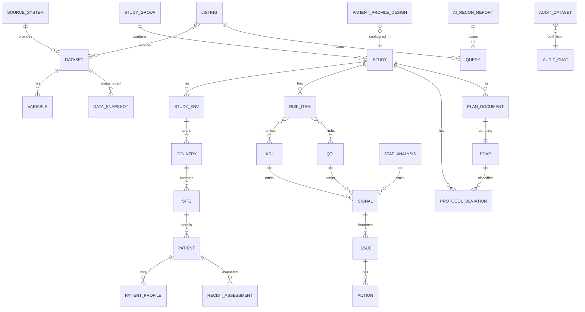

# DataStudio 功能需求文档（对标 Medidata Clinical Data Studio）

| 项目 | 内容 |
|---|---|
| 文档版本 | v2.0 |
| 状态 | 基于一手文档重建 |
| 产品 | DataStudio（临床试验数据质量管理平台） |
| 对标产品 | Medidata Clinical Data Studio（CDS） |
| 适用阶段 | 自研建设规格（内部产品/开发团队） |
| 语言 | 中文 |
| 一手来源 | Medidata Knowledge Hub，bundle `clinical-data-studio`（800+ 页），访问日期 2026-11-02 |

## 0. 来源与证据分级

本文档的证据分为四级，逐条标注：

| 标记 | 含义 |
|---|---|
| `[KHub]` | 来自 Medidata Knowledge Hub CDS 一手文档（页面名见第 18 章），可直接作为需求依据 |
| `[公开]` | 来自 Medidata 官网营销页（功能要点级） |
| `[推断]` | 一手/公开资料未覆盖，由临床数据管理领域常识补全 |
| `[假设]` | 数值或策略为默认假设，需评审确认 |

> **重要说明**：一手文档描述的是 Medidata CDS 的**行为与限制**，可作为本产品需求的对标基线。但一手文档不包含其内部实现、数据表结构、API 契约与算法参数；这些仍属 `[推断]`。

---

## 1. 需求编号与优先级

编号：`CDS-<模块>-<序号>`。模块代码：

| 代码 | 模块 |
|---|---|
| `PLT` | 平台定位与产品结构 |
| `PIPE` | 数据接入与流水线 |
| `DSV` | Data Surveillance（数据审阅） |
| `RB` | RBQM（风险质量管理） |
| `CSM` | Statistical Monitoring（统计监测） |
| `SIG` | Signals（信号） |
| `ATR` | Audit Trail Review（审计追踪审阅） |
| `PIR` | Protocol Integrity Report（方案完整性报告） |
| `XSM` | Cross Study Metrics（跨研究指标） |
| `ADM` | 平台管理/权限 |
| `DM` | 概念数据模型 |
| `STATE` | 状态机 |
| `NFR` | 非功能需求 |
| `REG` | 合规需求 |

优先级：P0 必须 / P1 应做 / P2 可延后。验收标准用 Given/When/Then。

---

## 2. 产品定位与产品结构

#### PLT-001 统一平台定位
- 优先级：P0 | 来源：`[KHub] About Clinical Data Studio`
- 描述：DataStudio 是统一的临床数据管理与质量平台，提供对 Medidata 与非 Medidata 来源集成数据的无缝访问；采用 no/low-code 环境，用 AI 简化数据汇聚、标准化与管理流程，使多角色基于实时数据协作，缩短审阅周期、提升质量、降低风险、改善患者安全。
- 验收标准：GWT-1 Given 研究存在多源数据，When 各角色登录，Then 在统一平台内看到同一份实时数据。

#### PLT-002 产品分档（Offerings）
- 优先级：P0 | 来源：`[KHub] About Clinical Data Studio`
- 描述：平台按两档提供：
  - **Medidata Data Surveillance**：含 Data Surveillance 能力套件 + Data Connect。
  - **Medidata Data Quality Management**：含上述全部，另加 **RBQM** 与 **Cross Study Metrics**。
- 验收标准：GWT-1 Given 客户订阅档位，When 登录，Then 仅显示该档位包含的模块。

#### PLT-003 能力套件清单
- 优先级：P0 | 来源：`[KHub] About Clinical Data Studio`
- 描述：平台须提供以下能力（命名沿用对标）：

| 套件 | 子能力 |
|---|---|
| Data Connect | Datasets、Imports、Exports、Transformations |
| Data Surveillance | Task Oversight、Clean Patient Tracker、Data Sets、Open EDC Queries、Vendor Queries、Listings、AI Reconciliation、Patient Profiles、Custom Graphs、Oncology RECIST 1.1、Data Surveillance Configuration |
| RBQM | Data Quality Hub、Risk Assessment、Risk Inventory、Plan Documents、Protocol Integrity Report、KRI Dashboard、QTL Dashboard、Statistical Monitoring、Signals、Audit Trail Review、RBQM Configuration、RBQM Template Library、Platform Library |
| Cross Study Metrics | Data Management Quality Metrics（KRIs、QTLs、Clean Patients）|

- 验收标准：GWT-1 Given 完整订阅，When 打开导航，Then 上表能力均可访问。

#### PLT-004 平台架构约束
- 优先级：P0 | 来源：`[KHub] About Clinical Data Studio`
- 描述：基于可扩展、灵活、开放、实时流式的数据架构；所有临床数据与多角色共享统一数据管理与分析体验。
- 验收标准：GWT-1 Given 源数据更新，When 流式处理完成，Then 下游模块在约定时延内可见。

---

## 3. 范围（Out of Scope）

- 自研 EDC / eSource 采集（数据来自 Rave 等外部 EDC）
- 随机化与药物供应（RTSM）
- 电子试验主文件（eTMF）
- 真实世界数据、影像、Sensors 的深度处理（仅保留通用接入能力）
- 通用 ETL / 数据仓库 / 全量数据长期存储
- AI 模型自建与训练（AI 以行为级需求对待）
- 法规提交本身（仅承诺 inspection-ready 的审计追踪与导出）

---

## 4. 角色与权限（ADM）

#### ADM-001 基于 Building Block 的权限模型
- 优先级：P0 | 来源：`[KHub] Grant Access to Clinical Data Studio`
- 描述：访问由"客户自定义平台角色 + 构建块（building block）"决定。角色须先在 Cloud Administration 配置，再分配给用户。至少存在三组构建块：Data Surveillance、RBQM、Data Connect。
- 验收标准：GWT-1 Given 用户角色缺少某 building block，When 访问对应功能，Then 拒绝或隐藏入口。

#### ADM-002 角色分配层级
- 优先级：P0 | 来源：`[KHub] Grant Access to Clinical Data Studio`
- 描述：支持在 **Client Division 级**与 **Study 级**分配角色；支持批量（一次最多 25 个邮箱）与用户文件上传。
- 验收标准：GWT-1 Given 管理员，When 在 study 级分配角色，Then 用户仅在该研究环境获得权限。

#### ADM-003 站点与国家范围访问
- 优先级：P0 | 来源：`[KHub] Grant Access / Information That You Can View...`
- 描述：Site/Country Access 决定用户可见数据范围；提取含 Rave 与 Audit CTMS 数据时须授予全部站点与国家。
- 验收标准：GWT-1 Given 用户仅有部分站点权限，When 查看列表，Then 仅显示其站点数据。

#### ADM-004 登录与导航
- 优先级：P0 | 来源：`[KHub] Log In, Navigate Medidata, and Access Studies`
- 描述：通过 iMedidata 邀请激活账号后登录；全局导航含 Clients / Study Groups / Studies / Sites；App 导航栏展示已关联应用（如 Rave）。
- 验收标准：GWT-1 Given 已激活用户，When 登录，Then 看到其被分配的研究、研究组与应用。

#### ADM-005 关键角色（业务视角）
- 优先级：P0 | 来源：`[KHub] About Clinical Data Studio` + `[推断]`
- 描述：平台面向 Clinical Data Managers/Scientists、Clinical Operations & Safety、Clinical Programmers & IT、C-Suite；监查侧含 Central Monitor、Central Statistical Monitor、CRA、Medical Monitor、Risk Manager、Study Manager。
- 验收标准：GWT-1 Given 各角色，When 登录，Then 仅见其职责相关模块（角色化透视）。

---

## 5. 数据接入与流水线（PIPE）

#### PIPE-001 多源接入
- 优先级：P0 | 来源：`[KHub] About Clinical Data Studio`
- 描述：接入 Rave 与第三方供应商数据（如方案偏离、实验室数据、任何未经 Rave 上传的数据）。第三方数据经 **Data Connect > Imports** 导入；旧研究可继续使用 **Ingestor**。
- 验收标准：GWT-1 Given 第三方数据集，When 通过 Imports 上传，Then 进入平台并可按 DTA 校验。

#### PIPE-002 数据传输协议（DTA）自动校验
- 优先级：P0 | 来源：`[KHub] About Clinical Data Studio`
- 描述：可配置 DTA，在数据导入时自动校验。
- 验收标准：GWT-1 Given 到达数据不符合 DTA，When 校验执行，Then 标记异常并阻断进入审阅。

#### PIPE-003 数据流水线前置条件
- 优先级：P0 | 来源：`[KHub] Clinical Data Studio's Data Pipeline`
- 描述：为使数据被正确摄取、分析、可视化，需满足：
  - 站点在国家地址中已配置国家；
  - 在 Rave Study Builder 创建研究表单；
  - 在 Rave Tagging 标记 **Enrolled Date 或 Randomization Date**（各只能选一个变量）；
  - 标记 **AE Start Date** 与 **AE Serious (AESER)**，且来自同一表单；
  - 在 Rave Architect 为访视定义 Target / Start Window / End Window（用于系统 KRI：Percent Missing Visit、Percent Out of Window Visit）；
  - 研究环境含与 Rave 目录结构 Day Zero 一致的 Set Time Zero 逻辑；
  - 访视结构中至少一个表单标记 Observation Date of Folder。
  - 第三方完全摄取研究：以 CDS Data Mapping 映射 Enrolled/Randomization。
- 验收标准：GWT-1 Given 未标记 Enrolled Date，When 刷新数据，Then 依赖该字段的分析不可用或报错。

#### PIPE-004 映射优先级与冲突规则
- 优先级：P1 | 来源：`[KHub] Clinical Data Studio's Data Pipeline`
- 描述：CDS 中配置的 patient milestone 映射**覆盖** Rave 中的配置；若 Rave 配置了多个 milestone 映射而 CDS 未配置，则 CDS 数据刷新失败。
- 验收标准：GWT-1 Given 两处映射冲突，When 刷新，Then 以 CDS 为准并记录。

#### PIPE-005 数据刷新频率与快照
- 优先级：P0 | 来源：`[KHub] Clinical Data Studio's Data Pipeline`
- 描述：Data Surveillance 与 RBQM 的研究数据**每日自动刷新 4 次**，约 9:00 / 15:00 / 21:00 / 3:00（EST）；UI 数据分别对应前一日 23:00、当日 5:00、当日 11:00、当日 17:00（EST）。每次刷新产生一个 data snapshot。Rave 更新与 Data Connect 激活数据集在 Data Surveillance/RBQM 中 **6–12 小时**内可用。
- 验收标准：GWT-1 Given 一次刷新完成，When 查看数据，Then 显示对应快照时间戳。

#### PIPE-006 各能力刷新差异
- 优先级：P1 | 来源：`[KHub] Clinical Data Studio's Data Pipeline`
- 描述：不同能力刷新节奏不同，须在 UI 显示时间戳：
  - Data Sets / Visualizations / KRI/QTL 配置值 / Risk Assessment Critical Data：随 4 次研究刷新更新；
  - KRI Dashboard / QTL Dashboard / Statistical Monitoring：可调度或手动刷新（默认每日 6:00 EST 提取 signals 数据）；
  - EDC Open Queries 报告：随研究刷新；
  - ATR：数据集发布后 15–30 分钟可用于 Data Sets/Listings/KRIs，已发布审计数据集按**每周一 9:00 EST** 刷新；ATR 数据预览为前一日 20:00 EST；
  - 提交的 query 状态 3–4 小时回写；Listings/AI Reconciliation 提交到 Rave 近乎实时，提交到 Veeva EDC 约 3 小时；
  - Signals：每日 6:00 EST 提取，6:00 之后的自定义配置次日生效。
- 验收标准：GWT-1 Given 各模块，When 查看，Then 显示该模块最近快照时间。

#### PIPE-007 手动刷新
- 优先级：P1 | 来源：`[KHub] Data Pipeline`
- 描述：支持手动刷新 listings、AI Data Reconciliation、已发布 patient profile designs、RECIST 1.1、Clean Patient Tracker；AI Reconciliation 与 RECIST 1.1 每天最多刷新 2 次（依 Rave 刷新计划）。
- 验收标准：GWT-1 Given 新数据，When 点击 Refresh，Then 结果更新且显示刷新时间。

#### PIPE-008 数值范围限制
- 优先级：P1 | 来源：`[KHub] About Clinical Data Studio`
- 描述：仅支持 ±9,223,372,036,854,775,807 范围内的数值，超出显示为 null。
- 验收标准：GWT-1 Given 超范围数值，When 显示，Then 呈现为 null。

#### PIPE-009 数据约束
- 优先级：P0 | 来源：`[KHub] Data Pipeline`
- 描述：
  - 不支持同一 Patient ID 的多个患者（即使来自不同站点）；否则分析结果不一致。
  - 不支持 Rave Publish-in-Place；更新数据类型/格式须新建 eCRF 版本。
  - 初始启用时应排除非盲数据（unblinded data）。
- 验收标准：GWT-1 Given 存在重复 Patient ID，When 摄取，Then 给出警告/结果可能不一致。

#### PIPE-010 日期时间格式支持
- 优先级：P1 | 来源：`[KHub] Data Pipeline`
- 描述：支持多种日期/日期时间格式（含 yyyy-MM-dd、dd/MM/yyyy、MMM-dd-yyyy、ISO 8601 带毫秒、yyyyMMdd 等）。
- 验收标准：GWT-1 Given 上述任一格式，When 摄取，Then 正确解析。

#### PIPE-011 丰富字段（Enriched Fields）
- 优先级：P2 | 来源：`[KHub] Data Pipeline`
- 描述：对含未知值的源字段自动添加 `_INT`、`_TXT`、`_DTC` 等丰富字段；Patient Profiles 建议使用 `_TXT`（显示字典文本）与 `_INT/_DTC`（日期）；Listings/Data Sets 中这些字段随源字段隐式消费。
- 验收标准：GWT-1 Given `AESer=1`，When 显示，Then `AESer_TXT` 显示为 Yes。

---

## 6. Data Surveillance（DSV）

### 6.1 Task Oversight / Data Oversight

#### DSV-001 Task Oversight 仪表盘
- 优先级：P1 | 来源：`[KHub] About Clinical Data Studio`
- 描述：集中展示来自 Patient Profiles、Vendor Queries、Listings、AI Reconciliation、Data Connect 的研究指标与 KPI，跟踪需审阅的患者数据进度。
- 验收标准：GWT-1 Given 各能力有待审记录，When 打开 Task Oversight，Then 汇总显示进度。

#### DSV-002 Data Oversight 仪表盘
- 优先级：P1 | 来源：`[KHub] Data Oversight: Monitor Counts...`
- 描述：监控问题（issues）、患者与研究数据的计数。
- 验收标准：GWT-1 Given 研究数据，When 打开 Data Oversight，Then 显示 issues/患者/数据计数。

### 6.2 Clean Patient Tracker

#### DSV-003 数据清理进度跟踪
- 优先级：P0 | 来源：`[KHub] About Clinical Data Studio` / `Track and Clean Unclean Patient Data...`
- 描述：可视化、列出并按优先级排序跨 Data Surveillance 的未清患者数据任务；可下钻到患者级；"Unclean Patients" 已更名为 "In Progress Patients"。
- 验收标准：GWT-1 Given 研究进行中，When 打开 CPT，Then 显示各患者清理状态并可下钻。

#### DSV-004 CPT 可跟踪 listings 与供应商 query
- 优先级：P1 | 来源：`[KHub] Clean Patient Tracker: Track Up To 25 Listings` / `Monitor Vendor Queries`
- 描述：CPT 最多跟踪 **25 个 listings**；可监控 vendor queries 数据；可下载 CPT 患者列表与 open queries 列表。
- 验收标准：GWT-1 Given 已跟踪 listings，When 查看 CPT，Then 显示其未审记录数。

#### DSV-005 Missing Pages 自动填充
- 优先级：P2 | 来源：`[KHub] Configure CPT to Autopopulate Missing Page Counts`
- 描述：当来源为 Rave 时，Missing Pages Count 列不可编辑，可由系统自动填充；否则可手工维护。
- 验收标准：GWT-1 Given Rave 来源，When 查看该列，Then 为只读且自动填充。

### 6.3 Data Sets 与 Open EDC Queries

#### DSV-006 Data Sets 审阅
- 优先级：P0 | 来源：`[KHub] About Clinical Data Studio`
- 描述：监控来自 Rave 与第三方的高风险、关键或复杂研究数据；识别 Rave 与外部数据集来源。
- 验收标准：GWT-1 Given 数据集，When 打开 Data Sets，Then 列出变量与记录并标明来源。

#### DSV-007 Open EDC Queries 统一视图
- 优先级：P1 | 来源：`[KHub] About Clinical Data Studio`
- 描述：在一处查看研究中针对患者数据的所有未关闭与已答复 query 明细；含 Open By、query 数据列、query 响应文本与数据快照时间戳。
- 验收标准：GWT-1 Given 多个 query，When 打开页面，Then 统一列出并可按列筛选。

### 6.4 Vendor Queries

#### DSV-008 供应商问题上报与跟踪
- 优先级：P1 | 来源：`[KHub] Vendor Queries: Vendor Query Shows Vendor Personnel Name...`
- 描述：向供应商上报并跟踪外部数据问题；可配置 Vendor Groups 将 query 集分配给供应商；供应商答复后显示供应商人员姓名；可查看/导出审计报告。
- 验收标准：GWT-1 Given 供应商 query，When 供应商答复，Then 显示其姓名并可留痕。

### 6.5 Listings

#### DSV-009 无编程 listings 构建
- 优先级：P0 | 来源：`[KHub] Create And View Listings`
- 描述：通过条件表达式解析研究数据，识别并报告可能指示风险的记录；从多数据集选择变量构建，无需编程。
- 验收标准：GWT-1 Given 多源数据，When 配置 listings，Then 生成结果并支持下钻。

#### DSV-010 从 listings 提交 query
- 优先级：P0 | 来源：`[KHub] Create Rave Queries Directly from Listings` / `Rave Access Required...`
- 描述：可对 Rave 来源记录直接提交 Rave query（含 Add Column 字段、替代 marking group）；提交 Veeva EDC 数据 query 同样支持；无 Rave 访问或无权限时 Submit Query 不可用。
- 验收标准：GWT-1 Given Rave 数据与权限，When 提交 query，Then query 写入 EDC 且状态回写。

#### DSV-011 Listings 刷新与历史
- 优先级：P1 | 来源：`[KHub] Listings: Get Newest Listings Data...` / `Maintain Data Continuity After Data Refreshes...`
- 描述：支持按需与计划刷新；刷新后使用 "dropped listing records" 维持数据连续性；可查看 listings 历史（含已批准 listings 中数据点变化标识，需审批）。
- 验收标准：GWT-1 Given 刷新，When 数据变化，Then 标记变化记录且保留历史。

#### DSV-012 Listings 状态与模板
- 优先级：P1 | 来源：`[KHub] Listings: Mark Listings As In Progress...` / `Save and Reuse Listing Configurations as Templates`
- 描述：审阅周期内可将 listings 标记为 In Progress；listing 配置可存为模板复用与跨研究复制；Listing Manager 可启用/停用 listings。
- 验收标准：GWT-1 Given 审阅中，When 标记 In Progress，Then 状态保留且可续审。

#### DSV-013 Listings 规模与导出
- 优先级：P1 | 来源：`[KHub] Listings: Preview Listings With Up To Thirty Thousand Records`
- 描述：预览最多 30,000 条记录；可导出 listings 与 listings 历史；跨数据集创建、missing records、跨数据集查询等受 ATR 数据集限制时不支持。
- 验收标准：GWT-1 Given 大列表，When 预览，Then 最多显示 30,000 条并提示。

### 6.6 AI Reconciliation（AI 数据对账）

#### DSV-014 AI 对账报告集
- 优先级：P0 | 来源：`[KHub] Reconcile Data Accurately Using Data Reviewer Algorithms`
- 描述：使用内置算法自动对账，提供 6 个报告：
  - AE 类 4 个：AEs without CMs、Worsening AEs、Overlapping AEs、Overlapping non-worsening AE and ongoing MH；
  - CM 类 2 个：Overlapping CMs、CMs without AEs or ongoing MH。
- 验收标准：GWT-1 Given AE/CM/MH 数据，When 运行对账，Then 生成对应报告。

#### DSV-015 置信度与人工复核
- 优先级：P0 | 来源：`[KHub] Reconcile Data Accurately...`
- 描述：每条记录显示 Confidence（High/Medium/Low）；用户可 Agree/Disagree；可 Mark Reviewed；可提交 Rave query；子记录可 Link 到父记录并标记父记录已审。
- 验收标准：GWT-1 Given 一条 AI 记录，When 用户 Disagree，Then 记录反馈并显示不同意图标。

#### DSV-016 对账刷新
- 优先级：P1 | 来源：`[KHub] Reconcile Data Accurately...`
- 描述：Refresh Data 刷新所有对账报告，刷新期间按钮禁用；显示完成时间；有新数据时按钮重新可用。
- 验收标准：GWT-1 Given 刷新完成，When 查看，Then 显示时间戳。

### 6.7 Patient Profiles

#### DSV-017 患者档案设计器
- 优先级：P0 | 来源：`[KHub] About Clinical Data Studio` / `Patient Profiles Features`
- 描述：用表格、flags、图表、时间线构建 patient profile designs，用于识别安全信号并确保患者数据一致性；支持 transposed table、wide table、event table、timeline、notes、display/highlight conditions、data set variable types。
- 验收标准：GWT-1 Given 数据集，When 设计 profile，Then 可拖拽组合元素并预览。

#### DSV-018 设计与审阅流程
- 优先级：P0 | 来源：`[KHub] Patient Profiles Features`
- 描述：设计可复制（研究内/跨研究/跨环境/跨 client division）、可标记为 blinded/unblinded、可标记为 Master（只读）、可发布为 View Only 或 Master；设计有报告与审计历史；患者档案可标记为 Reviewed，审阅与评论进审计。
- 验收标准：GWT-1 Given 设计，When 发布为 Master，Then 变为只读并供其他角色查看。

#### DSV-019 刷新与 PDF
- 优先级：P1 | 来源：`[KHub] Patient Profiles: Get Newest Published Designs Data...` / `Generate Patient Profiles PDF in Bulk`
- 描述：已发布设计支持按需与计划刷新；可按站点/权限批量生成患者档案 PDF（含中文），PDF 页脚含附加信息。
- 验收标准：GWT-1 Given 多患者，When 批量导出 PDF，Then 逐个生成并可下载。

### 6.8 Custom Graphs（自定义可视化）

#### DSV-020 自助可视化
- 优先级：P1 | 来源：`[KHub] Custom Graphs: Rebranded Visualizations...`
- 描述：自助数据可视化与报表工具，可在单张图上绘制任意数据集组合的关系，使用实时数据；支持按需与计划刷新、scatter plot、tabular visualization、summary table 高亮关键数据、最多 20 类的 donut 图、导出 PDF 含 summary table。
- 验收标准：GWT-1 Given 数据集，When 配置图表，Then 可复用模板并支持下钻。

### 6.9 Oncology RECIST 1.1

#### DSV-021 RECIST 1.1 仪表盘
- 优先级：P1 | 来源：`[KHub] PDS: Track Patient Tumor Burden Data with The RECIST 1.1 Dashboard`
- 描述：可视化、分类并列出肿瘤研究中患者的肿瘤负荷变化；支持：
  - 按 scan visit（默认 Last Scan Visit，排除 unscheduled）与 site 过滤；
  - 患者计数（Total、PD、SD、PR、CR、NE/NA）；
  - Tumor Burden Change (%) waterfall chart（y 轴按 RECIST 指南约为 +20% ~ -30%），条形从最差（PD）到最佳（CR）排序；
  - 悬停显示 Patient ID、Visit、Overall Response、Tumor % change，并可打开 spaghetti 图查看随时间变化；
  - 逐患者表格含 Site Entered 与 Algorithm Calculated 响应；两者不一致时显示警告图标；可标记已审/未审。
- 验收标准：GWT-1 Given 肿瘤数据，When 打开 RECIST 1.1，Then 显示瀑布图与逐患者响应表。

#### DSV-022 RECIST 映射依赖
- 优先级：P1 | 来源：`[KHub] Configuration and Reporting: Map Data Set and Variables for the RECIST 1.1 Dashboard`
- 描述：仅当在配置中完成 Oncology Mapping（RECIST）的源/目标变量映射后，仪表盘才工作；映射中显示数据集与变量的名称与 OID。
- 验收标准：GWT-1 Given 未配置映射，When 打开仪表盘，Then 提示配置缺失。

---

## 7. RBQM（RB）

### 7.1 Data Quality Hub

#### RB-001 Data Quality Hub 仪表盘
- 优先级：P0 | 来源：`[KHub] Data Quality Hub: Centralized, Prioritized View...`
- 描述：RBQM 默认首页（原 RBQM Summary 页），集中、按优先级展示站点级数据质量。卡片：
  - **Priority Focus**：列出 Site Impact Score 处于 top 25th percentile 的站点；Site Score = 该站点关联信号的 impact score 之和；Site Impact Score = Site Score / Total Study Impact Score；
  - **KRI**：站点级 KRI 表现（低/中/高风险站点数与占比），可点击进入预过滤 KRI Dashboard；
  - **QTL**：研究级 QTL 表现（In Range / Out of Range / Above Upper Limit），可点击进入 QTL Dashboard；
  - **Risk Management**：风险总数及 overdue（当前日期晚于 Target Review Date）与 due soon（Target Review Date 在 1 周内）的数量；
  - **Open Signals**：未关闭信号总数及 In Progress / Overdue / lingering（打开超过 30 天）数量；
  - **Risk Inventory**：按状态与严重度的风险计数；
  - **Patients Cleaned By Site**：各站点 cleaned vs in progress 患者数；
  - **All Signals By Site**：各站点信号明细（站点号、国家、Site Score、信号总数、各模块来源计数、清理进度）。
- 验收标准：GWT-1 Given 研究风险数据，When 打开 Data Quality Hub，Then 按 Site Impact Score 排序显示站点并支持下钻到信号。

### 7.2 Risk Assessment / Risk Inventory / Plan Documents

#### RB-002 Risk Assessment 工作区
- 优先级：P0 | 来源：`[KHub] About Clinical Data Studio` / `Risk Assessment Features`
- 描述：跨团队持续迭代的风险记录工作区；识别与处理高优先级风险、评估风险表现、审阅与批准风险计划报告；支持将缓解措施（mitigations）关联到 functional plans；风险评估详情可导出 Excel。
- 验收标准：GWT-1 Given 风险团队，When 记录风险，Then 保留版本与审计。

#### RB-003 Risk Inventory
- 优先级：P0 | 来源：`[KHub] Risk Inventory`
- 描述：实时、全面的研究风险清单（含关联 QTL/KRI）；默认显示最高研究环境层级。研究环境从高到低：Production、Development、Functional Testing、Interactive Verification、UAT、Training、Other（自定义按字母序）。可按风险分排序、查看风险来源（Critical Data / Critical Process / Risk Category）并下钻编辑。
- 验收标准：GWT-1 Given 风险，When 排序，Then 最高分风险置顶。

#### RB-004 风险分类与评分
- 优先级：P0 | 来源：`[KHub] Risk Categorization and Risk Scoring`
- 描述：可用预定义模板或自定义分类模板（client division 级或 study 级）。预定义模板含 DCT Risk Assessment Considerations（源自 ACRO）、Medidata COVID-19、TransCelerate BioPharma RACT。风险分基于 Scoring by Product 方法，采用 High/Medium/Low 三点量表；可为问题、风险或风险类目赋分；Total Risk Categorization Score = 各 Risk Category Score 之和。
- 验收标准：GWT-1 Given 风险类目，When 赋分，Then 汇总总分显示在页面顶部。

#### RB-005 Plan Documents / IQMP
- 优先级：P1 | 来源：`[KHub] Plan Documents` / `RBQM: Ensure Study Data Accuracy Using Integrated Data Quality Plans`
- 描述：构建并发布综合数据质量计划（IQMP）与 functional plans，用于全程审阅与监控数据。
- 验收标准：GWT-1 Given 计划，When 发布，Then 可用于稽查导出。

### 7.3 KRI Dashboard / QTL Dashboard

#### RB-006 KRI Dashboard 与系统 KRI
- 优先级：P0 | 来源：`[KHub] About Clinical Data Studio` / `Key Risk Indicators Released Features`
- 描述：展示研究监控的 KRI 及其在各站点/国家的取值；支持内置系统 KRI 与用户自定义 KRI（含自定义百分比 KRI）；可过滤、排序、显示计数、查看站点/国家历史趋势、查看患者级数据、导出 KRI 表快照。
- 验收标准：GWT-1 Given KRI 配置，When 打开仪表盘，Then 显示各站点 KRI 值并可下钻到患者。

#### RB-007 KRI 配置
- 优先级：P0 | 来源：`[KHub] KRI Configuration Features`
- 描述：在 RBQM Configuration Manager 中新增/编辑自定义 KRI、启用/停用系统 KRI、配置自定义阈值、预览超过阈值的患者数、保存为模板、跨 client division 复用、查看配置审计、下载配置报告 PDF；系统 KRI 含 Modification Rate（标识数据修改率异常的站点）。
- 验收标准：GWT-1 Given 自定义 KRI，When 保存，Then 参与监控并在越限时告警。

#### RB-008 QTL Dashboard 与配置
- 优先级：P0 | 来源：`[KHub] QTL Configuration Features`
- 描述：展示研究监控的 QTL 表现；支持自定义 QTL（可针对特定数据子集）、启用/停用、模板复用、当前与历史趋势、患者级数据、预览/导出综合 QTL 报告、越限通知；QTL 状态语义为 In Range / Out of Range / Above Upper Limit。
- 验收标准：GWT-1 Given QTL，When 越限，Then 触发通知并生成信号。

#### RB-009 刷新调度
- 优先级：P1 | 来源：`[KHub] RBQM: Schedule Data Refreshes Using the KRI/QTL Scheduler`
- 描述：KRI Dashboard、QTL Dashboard、Statistical Monitoring 可调度或手动刷新，含每日调度与历史快照。
- 验收标准：GWT-1 Given 调度，When 到点，Then 自动刷新并产生快照。

### 7.4 Statistical Monitoring（CSM）

#### CSM-001 Data Anomaly Detection（Error Plots）
- 优先级：P0 | 来源：`[KHub] Determine Study Data Outliers, Risks, and Trends Using Error Plots`
- 描述：对单变量或变量对做 AI 可视化分析，发现离群、异常、风险与趋势；离群点可 Flag、Track、Audit（可查看 Rave query 及评论与状态历史）；可配置参与分析的数据集与变量；支持打开对应患者档案。
- 验收标准：GWT-1 Given 数据，When 运行 error plot，Then 显示离群点并可标记/审阅。

#### CSM-002 Trends 图
- 优先级：P1 | 来源：`[KHub] Trends Plots Improve Your Ability to Monitor Variable Data Across Sites`
- 描述：用箱线图或堆叠条形图并排展示各站点单变量数据，定位异常/错误站点。
- 验收标准：GWT-1 Given 变量，When 查看 trends，Then 各站点并排比较。

#### CSM-003 Weekend and Holiday Visits
- 优先级：P1 | 来源：`[KHub] View and Create Issues on the Weekend and Holiday Visits Page`
- 描述：按研究或国家查看每日计划的访视分布；查看周末/假日访视以识别潜在伪造或错误记录；可从页面创建 issues；可按 visit name 过滤。
- 验收标准：GWT-1 Given 访视数据，When 查看，Then 标记非工作日访视并可创建 issue。

#### CSM-004 Potential Duplicate Patients
- 优先级：P1 | 来源：`[KHub] Uncover Potential Duplicate Patients`
- 描述：交互式热力图展示被识别为潜在重复患者的站点；结合人口学与地理信息；对无可识别地址的站点做适配；支持导出。
- 验收标准：GWT-1 Given 多站点数据，When 检测，Then 输出疑似重复与证据。

#### CSM-005 Rounding and Propagation
- 优先级：P1 | 来源：`[KHub] Identify Sites That Potentially Round or Propagate Vital Sign Records`
- 描述：用热力图识别潜在舍入与传播（如生命体征记录）的站点/患者；含汇总表、患者列表过滤（有/无舍入事件）、下载汇总清单、历史视图；可配置参与分析的生命体征数据。
- 验收标准：GWT-1 Given 生命体征数据，When 运行，Then 输出舍入/传播热力图与列表。

#### CSM-006 Event Incidence
- 优先级：P1 | 来源：`[KHub] View Event Incidence at the Site- and Study-level`
- 描述：展示某 domain 内事件报告数与发生率（站点/研究级），用于判断是否需进一步调查或停药。
- 验收标准：GWT-1 Given 事件数据，When 查看，Then 显示站点与研究级发生率。

#### CSM-007 Under-Over Reporting Events
- 优先级：P1 | 来源：`[KHub] View Under- and Overreporting Event Trends...`
- 描述：可视化 AE、CM、MH 在站点与国家层面的报告模式，识别显著偏离研究常态的站点/国家。
- 验收标准：GWT-1 Given AE/CM/MH，When 查看，Then 显示报告不足/过度趋势。

#### CSM-008 Statistical Monitoring History
- 优先级：P1 | 来源：`[KHub] History Features`
- 描述：为 Statistical Monitoring 各能力调度或手动触发刷新，并查看历史数据快照；可停止/暂停计划刷新；显示当前分析状态与错误详情。
- 验收标准：GWT-1 Given 快照，When 查看历史，Then 可切换并比较。

---

## 8. Signals（SIG）

#### SIG-001 信号定义与来源
- 优先级：P0 | 来源：`[KHub] RBQM: Identify Potential Study Data Issues Using Signals`
- 描述：**信号（signal）** 是数据分析发现的潜在问题告警；**问题（issue）** 是经中心监查审阅、站点讨论或访视验证后确认的发现。信号从以下能力读取数据：Patient Profiles、KRIs、QTLs、Rounding、Propagation、Potential Duplicate Patients、Under/over Reporting。
- 验收标准：GWT-1 Given 上述模块，When 生成信号，Then 汇总到统一 Signals 报告。

#### SIG-002 自动与手动信号
- 优先级：P0 | 来源：`[KHub] RBQM: Identify Potential Study Data Issues Using Signals`
- 描述：每个信号是满足所设阈值的 observation，来源于所配置的模块；可基于阈值自动创建，也可手工创建（需 Manage Signals）。须先在 Signals Configuration 中选择要报告并设阈值的模块。
- 验收标准：GWT-1 Given 配置阈值，When 刷新，Then 满足阈值的 observation 生成信号。

#### SIG-003 Signals 报告字段与操作
- 优先级：P0 | 来源：`[KHub] RBQM: Identify Potential Study Data Issues Using Signals`
- 描述：Signals 表列含 Signal ID、Site、Country、Patient、Analysis、Name、Observation、Description、Due Date、Status、Assignee、Category、Opened By/Date、Closed By/Date、Issues。行内操作含 resolve、dismiss、reopen、close、watch、clear signals、raise as issue、create actions、view signal details。支持按 Signal ID/Site/Country/Patient/Analysis/Name/Status 过滤与搜索。
- 验收标准：GWT-1 Given 信号，When 分配责任人，Then 记录 assignee 并通知。

#### SIG-004 刷新与快照
- 优先级：P0 | 来源：`[KHub] RBQM: Identify Potential Study Data Issues Using Signals`
- 描述：研究数据每日约 6:00 EST 自动刷新；点击 Refresh 按各模块最近一次成功更新与阈值生成信号；页面显示各模块最近快照日期时间；6:00 EST 后的自定义配置次日生效；自动信号刷新只做一次，观察值低于阈值后不再更新（显示最近一次满足阈值的值）。
- 验收标准：GWT-1 Given 多模块，When 打开 Module Status，Then 显示各模块快照时间。

#### SIG-005 Signals 权限与限制
- 优先级：P0 | 来源：`[KHub] RBQM: Identify Potential Study Data Issues Using Signals`
- 描述：View Signals 可查看报告、增改/分配 actions、resolved、查看审计报告；Manage Signals 额外可创建、分配、dismiss、watch、close。若在配置中对某数据集开启 Rounding/Propagation 的 pivot，则不能为其生成/配置信号。某模块出错时，该模块的自动信号可能与仪表盘不一致，但 Module Snapshot 仍反映最新快照。
- 验收标准：GWT-1 Given 仅 View Signals，When 尝试创建信号，Then 拒绝。

#### SIG-006 信号转问题（内部或 CTMS）
- 优先级：P0 | 来源：`[KHub] Signals: Resolve Issues Within Signals Or Using External Issue Management...`
- 描述：对 Open/Reopened 信号可 Raise an issue：
  - 可发到外部 CTMS（如 Rave CTMS），或
  - 在 Signals 内部解决。
  发往 CTMS 时可选 PD 或 Non-PD 类型；发往 CTMS 的问题完全在 CTMS 内跟踪解决，仅**状态**回传 Signals；问题级别为站点级与研究级。CTMS 中关闭信号关联的 issue 不会因关闭信号而自动关闭。
- 验收标准：GWT-1 Given 信号，When 选择 Send to CTMS 并发起，Then 创建 CTMS issue 且 Signals 的 Issues 列显示 Yes。

#### SIG-007 发往 CTMS 的字段与规则
- 优先级：P0 | 来源：`[KHub] Signals: Resolve Issues...`
- 描述：Create CTMS Issue 面板字段：Country/Site/Issue Type/Issue created by/Issue created（自动填充）、Assignee（必填）、Description，以及 PD 专属：Protocol deviation category/severity/subcategory（必填）、IRB/Sponsor/Regulatory notification required。Non-PD 专属：Severity/Category/Subcategory/Visibility（必填）。有 actions 分配给信号时不能发往 CTMS；每个信号可针对每种类型发起多个 issue；QTL 或用户生成信号若无关联站点则不能创建 PD issue。
- 验收标准：GWT-1 Given 无站点信号，When 尝试创建 PD issue，Then 拒绝。

#### SIG-008 内部问题解决
- 优先级：P1 | 来源：`[KHub] Signals: Resolve Issues...`
- 描述：PD 或 Non-PD 均可在 Signals 内发起；内部解决只能为每个信号发起一个 issue；已有内部 issue 时 Raise an issue 按钮禁用；可通过 Clear Issue 解决；Resolution 需填写 root cause、mitigation、description。重复患者问题仅当团队成员同时被分配到站点与国家时才可指定。
- 验收标准：GWT-1 Given 已有内部 issue，When 再发起，Then 按钮禁用。

#### SIG-009 Signals 审计与导出
- 优先级：P1 | 来源：`[KHub] Signals: Download Signals In PDF Format` / `Track Signal Action Progress Using the Actions Tab`
- 描述：Signals Audit Report 记录所有操作与更新，可导出 Excel/CSV/PDF；信号可下载为 PDF；Actions 标签跟踪 action 进度；支持预置过滤器、评论、下载；UI 显示变更数据。
- 验收标准：GWT-1 Given 信号操作，When 打开审计报告，Then 可见全部操作并可导出。

#### SIG-010 信号 UI 与集成
- 优先级：P1 | 来源：`[KHub] Signals: View Issue Actions And Comments From Rave CTMS In Signals`
- 描述：可在 Signals 中查看来自 Rave CTMS 的 issue actions 与 comments；Create CTMS Issue UI 含附加字段；Signals 表可识别 Issue Type 与 Issue Target。
- 验收标准：GWT-1 Given CTMS issue，When 查看 Signals，Then 显示其 actions 与 comments。

---

## 9. Audit Trail Review（ATR）

#### ATR-001 生成式 AI 审计追踪审阅
- 优先级：P0 | 来源：`[KHub] RBQM: Enhance Study Data Compliance And Accuracy With Audit Trail Review` / `Audit Trail Review`
- 描述：ATR 拉取 Rave EDC 的操作元数据以展示数据端点的编辑、更新、删除；用 LLM/GenAI 自动构建定制查询并针对 Rave 操作数据执行，生成有意义的审计数据集。入口为 RBQM 标签下的 Audit Trail Review。
- 验收标准：GWT-1 Given 自然语言问题，When 提交，Then 返回审计数据集预览。

#### ATR-002 对话界面
- 优先级：P0 | 来源：`[KHub] RBQM: Enhance...ATR`
- 描述：New Audit Review 区含欢迎语、GenAI 聊天、预置提示问题与自由输入框；界面会用简明查询语言复述问题供确认；可 Save Prompt 保存并复用；未保存切换时提示 leave without saving / stay。
- 验收标准：GWT-1 Given 问题，When 复述有误，Then 用户可重新输入并确认。

#### ATR-003 数据预览与下载
- 优先级：P0 | 来源：`[KHub] RBQM: Enhance...ATR`
- 描述：Data Preview 按问题拉取数据，列含 patient name、site、country、folder、form、log、audit action、audit user name、audit date/time；可下载 CSV（完成后通知中心给链接）；展开视图显示数据集前 100 条并支持搜索/过滤/下载/发布。
- 验收标准：GWT-1 Given 匹配数据，When 预览，Then 显示上述列；无匹配则空白。

#### ATR-004 发布为审计数据集
- 优先级：P0 | 来源：`[KHub] RBQM: Enhance...ATR`
- 描述：Publish as dataset 后可在 Data Sets、Listings、KRIs 中使用。每个研究环境最多发布 **10 个**审计数据集（达上限后按钮禁用）。发布需 Manage Audit Trail Review 权限；提问与保存 prompt 需 View Audit Trail Review。
- 验收标准：GWT-1 Given 已发布数据集，When 在 Listings 引用，Then 可用；不可下载/发布空结果。

#### ATR-005 发布节奏
- 优先级：P1 | 来源：`[KHub] Data Pipeline` / `RBQM: Enhance...ATR`
- 描述：审计工作流每周周末运行；数据集发布后 15–30 分钟内可用于 Data Sets/Listings/KRIs；已发布审计数据集按每周一 9:00 EST 刷新；数据预览为前一日 20:00 EST。
- 验收标准：GWT-1 Given 已发布数据集，When 到刷新周期，Then 更新数据。

#### ATR-006 ATR 限制（必须实现为边界/提示）
- 优先级：P0 | 来源：`[KHub] RBQM: Enhance...ATR`
- 描述：ATR **不支持**：聚合（如"修改超过 10 次"）、复杂计算或时间戳差值、数据点以外的层级结果（如"列出所有站点"）、按数据点值过滤、请求全部审计数据。已发布审计数据集的过滤仅限：audit user、audit date/range、form oid、field oid、audit subcategories、patient ID、country、site。已发布审计数据 listings 不支持：提交 query、提交 vendor query、跨数据集 listing、missing records。请求处理超过 5 分钟会超时。不显示非盲数据。
- 验收标准：GWT-1 Given 聚合型问题，When 提交，Then 结果不满足预期或给出提示。

---

## 10. Protocol Integrity Report（PIR）

#### PIR-001 方案偏离集中跟踪
- 优先级：P0 | 来源：`[KHub] Protocol Integrity Report: Protocol Integrity Report Now Available`
- 描述：PIR 集中并自动化方案偏离跟踪；聚合来自 Rave EDC queries、clinical data listings 与手工录入的偏离到单一仪表盘；以 Protocol Deviation Assessment Plan (PDAP) 分类。取代手工跟踪与分类，确保一致与合规，提供审阅/审批工作流、审计追踪，并能检测重复偏离。
- 验收标准：GWT-1 Given 多源偏离，When 打开 PIR，Then 统一展示并可分类。

#### PIR-002 偏离工作流与状态
- 优先级：P0 | 来源：`[KHub] Protocol Integrity Report...`
- 描述：用户在 Proposed、In Review、Confirmed 状态审阅偏离，最终定为 Approved 或 Dismissed。涉及角色为 View Protocol Deviation 与 Manage Protocol Deviation。
- 验收标准：GWT-1 Given 偏离，When 提交，Then 按状态流转并需最终批准/驳回。

#### PIR-003 集成与自动填充
- 优先级：P0 | 来源：`[KHub] Protocol Integrity Report...`
- 描述：集成 Rave EDC，导入以 "PD" / "Potential PD" 等前缀开头的 Answered 或 Closed query；集成 Listings 导入被标记的记录。PIR 依据 PDAP 自动填充 Category、Impact on Data、Classification（不可编辑），并自动把来自 listings 的记录标记为已审。排除非盲数据上的 query。
- 验收标准：GWT-1 Given 前缀 PD 的 Rave query，When 导入，Then 生成偏离并自动分类。

#### PIR-004 PDAP 配置与发布
- 优先级：P0 | 来源：`[KHub] Protocol Integrity Report...`
- 描述：须在 Plan Documents 中配置并发布 PDAP 才能映射偏离；须为 Rave EDC query 配置特定前缀以启用自动识别；PIR 从最新已发布 plan document 获取 PDAP 详情。
- 验收标准：GWT-1 Given 未发布 PDAP，When 导入偏离，Then 无法自动分类。

#### PIR-005 Plan Document 版本规则
- 优先级：P1 | 来源：`[KHub] Protocol Integrity Report...`
- 描述：Plan 只能在 Draft 版本编辑；仅最近一次 plan 作为 active（无论 Draft 或 Published），更旧版本归档，其他更旧 plan 从界面移除；用户同时只能有一个 draft 与一个 published plan。
- 验收标准：GWT-1 Given 已发布 plan，When 再次编辑，Then 形成新 draft。

---

## 11. Cross Study Metrics（XSM）

#### XSM-001 跨研究数据管理质量指标
- 优先级：P1 | 来源：`[KHub] About Clinical Data Studio`
- 描述：提供跨研究的组合级视图，汇总上游能力的相关数据，包括 KRI、QTL、Clean Patients 三组仪表盘。
- 验收标准：GWT-1 Given 多研究，When 打开 Cross Study Metrics，Then 汇总显示。

---

## 12. 概念数据模型（DM）

> 概念级；实体名依据一手文档命名。

### 12.1 实体

| 实体 | 说明 | 来源 |
|---|---|---|
| Study / Study Group / Client Division | 研究与权限层级 | `[KHub]` |
| Study Environment | Production…Other 的环境层级 | `[KHub] Risk Inventory` |
| Country / Site / Patient | 地理与受试者层级 | `[KHub]` |
| Source System / Dataset / Variable / VariableType | 源与数据集 | `[KHub]` |
| DataTransferAgreement (DTA) | 导入校验约定 | `[KHub]` |
| DataSnapshot | 数据快照（含时间戳） | `[KHub]` |
| DerivedVariable / StackedDataset | 派生变量与堆叠数据集 | `[KHub]` |
| Listing / ListingTemplate | 列表视图与模板 | `[KHub]` |
| Query / VendorQuery | EDC 质疑与供应商质疑 | `[KHub]` |
| AIRconciliationReport | AI 对账报告（6 类） | `[KHub]` |
| PatientProfileDesign / PatientProfile | 患者档案设计与实例 | `[KHub]` |
| CustomGraph | 自定义可视化 | `[KHub]` |
| RecistAssessment | RECIST 1.1 评估（site entered vs calculated） | `[KHub]` |
| CleanPatientTask | 数据清理任务 | `[KHub]` |
| RiskItem (Risk Inventory) | 风险条目 | `[KHub]` |
| RiskCategory / RiskScore | 风险类目与评分 | `[KHub]` |
| CtQFactor (Critical Data / Critical Process) | 关键数据/流程 | `[KHub]` |
| KRI / QTL | 关键风险指标 / 质量容忍限 | `[KHub]` |
| StatisticalMonitoringAnalysis | 误差图/趋势/事件发生率/重复患者/舍入/报告不足 | `[KHub]` |
| Signal / SignalConfiguration | 信号与配置 | `[KHub]` |
| Issue / Action | 问题与动作（内部或 CTMS） | `[KHub]` |
| AuditDataset / AuditChat | 审计数据集与对话 | `[KHub]` |
| ProtocolDeviation / PDAP | 方案偏离与评估计划 | `[KHub]` |
| PlanDocument (IQMP/Draft/Published) | 计划文档 | `[KHub]` |
| DataQualityHubCard | 数据质量中心卡片 | `[KHub]` |
| Notification / AuditTrailEntry | 通知与审计条目 | `[推断]` |

### 12.2 关系（Mermaid）

---

## 13. 状态机（STATE）

#### STATE-001 信号状态
- 来源：`[KHub] Signals`
- 状态：`Open → (Resolved | Dismissed | Watched | Closed | Reopened)`；开信号可由操作触发 resolve/dismiss/reopen/close/watch/clear。
- 规则：关闭带有未关闭 CTMS issue 的信号，不会自动关闭该 issue。

#### STATE-002 问题状态
- 来源：`[KHub] Signals`
- 内部问题：在 Signals 内跟踪、审阅、解决；需 root cause、mitigation、description。
- CTMS 问题：在外部 CTMS 跟踪与解决，仅状态回传；动作影响 Signals 中的 issue outcome。

#### STATE-003 方案偏离状态
- 来源：`[KHub] Protocol Integrity Report`
- 状态：`Proposed → In Review → Confirmed → Approved | Dismissed`。

#### STATE-004 QTL 状态
- 来源：`[KHub] Data Quality Hub`
- 状态：`In Range → Out of Range → Above Upper Limit`。
- 语义：Within tolerance=健康；Out of Range=超容忍阈值（at risk）；Above Upper Limit=超上限（high risk）。

#### STATE-005 风险审阅状态
- 来源：`[KHub] Data Quality Hub`
- 状态：open / closed / watch / transfer；审阅时效为 Overdue（当前>Target Review Date）与 Due Soon（Target Review Date 在 1 周内）。

#### STATE-006 数据快照/刷新状态
- 来源：`[KHub] Data Pipeline`
- 说明：每次刷新产生 snapshot；各模块显示最近快照时间与刷新人；Signals 自动刷新只做一次，低于阈值后保留最近满足阈值的 observation。

#### STATE-007 Plan Document 状态
- 来源：`[KHub] Protocol Integrity Report`
- 状态：`Draft → Published`；同时仅一个 draft 与一个 published。

---

## 14. 非功能需求（NFR）

| 编号 | 需求 | 值/说明 | 来源 |
|---|---|---|---|
| NFR-001 | 研究数据自动刷新频率 | 每日 4 次，约 9:00/15:00/21:00/3:00 EST；Rave 数据 6–12h 可用 | `[KHub]` |
| NFR-002 | Signals 数据刷新 | 每日 6:00 EST 提取；6:00 后配置次日生效 | `[KHub]` |
| NFR-003 | ATR 发布延迟与刷新 | 发布后 15–30 分钟可用于 Data Sets/Listings/KRIs；周一 9:00 EST 周刷新 | `[KHub]` |
| NFR-004 | Query 状态回写 | Rave 3–4 小时；Veeva EDC 提交约 3 小时；Rave 提交近乎实时 | `[KHub]` |
| NFR-005 | ATR 处理超时 | LLM 处理超过 5 分钟请求超时 | `[KHub]` |
| NFR-006 | Listings 预览上限 | 30,000 条记录 | `[KHub]` |
| NFR-007 | ATR 已发布数据集上限 | 每研究环境 10 个 | `[KHub]` |
| NFR-008 | ATR 展开预览 | 前 100 条 | `[KHub]` |
| NFR-009 | CPT 可跟踪 listings 上限 | 25 个 listings | `[KHub]` |
| NFR-010 | 数值范围 | ±9,223,372,036,854,775,807，超范围显示 null | `[KHub]` |
| NFR-011 | 批量角色分配 | 一次最多 25 个邮箱 | `[KHub]` |
| NFR-012 | AI 对账/ RECIST 手动刷新 | 每天最多 2 次 | `[KHub]` |
| NFR-013 | 并发/吞吐/可用性 SLA | 待定 | `[假设]` |
| NFR-014 | 安全 | TLS、静态加密、凭据托管、最小权限、导出审批 | `[推断]` |
| NFR-015 | 本地化 | 支持中文 PDF（患者档案）；多语言待定 | `[KHub] + [假设]` |
| NFR-016 | 可观测性 | 各模块显示刷新时间、刷新人、快照、错误详情 | `[KHub]` |

---

## 15. 合规需求（REG）

#### REG-001 审计追踪（21 CFR Part 11 / ALCOA+）
- 来源：`[KHub]`（Signals Audit Report、ATR、PIR audit trail）+ `[推断]`
- 系统须为创建/修改/删除电子记录生成安全、计算机生成、带时间戳的审计追踪；不得由用户关闭或修改。

#### REG-002 访问控制
- 来源：`[KHub] Grant Access`
- 基于 building block 的角色 + Site/Country Access 的最小权限；职责分离由角色配置实现。

#### REG-003 电子签名
- 来源：`[推断]`
- 关键签核（PIR 审批、风险计划批准）需法规意义上的电子签名；适用范围待 GxP 范围确认。

#### REG-004 数据隔离与隐私
- 来源：`[KHub]`（blinded/unblinded、非盲数据排除）
- 研究级隔离；支持盲态/非盲设计；ATR 与 PIR 不显示非盲数据；受试者隐私处理合法性基础待确认。

#### REG-005 数据留存与法定冻结
- 来源：`[推断]`
- 可配置留存与法定冻结；期限待临床制药法规与公司政策确认。

#### REG-006 数据完整性（ALCOA+）
- 来源：`[KHub] ATR`
- 记录全部变更 who/when/what；转换血缘；审计数据集可用于 KRIs/Listings。

#### REG-007 AI 合规与人工复核
- 来源：`[KHub] AI Reconciliation / ATR` + `[推断]`
- AI 输出为建议（Confidence + Agree/Disagree），不得自动裁决；可关闭；可追溯；ATR 不显示非盲数据。

#### REG-008 ICH E6(R3) / RBQM
- 来源：`[KHub] RBQM`
- 支持 CtQ（Critical Data/Process）、RACT（含 TransCelerate 模板）、IQMP、KRI、QTL、中心统计监测。

#### REG-009 检查就绪
- 来源：`[KHub]`
- 可导出审计追踪、信号/问题/偏离处置记录、KRI/QTL 配置报告、数据转换血缘。

#### REG-010 计算机化系统验证（CSV）
- 来源：`[KHub] Medidata Validation Portal` + `[推断]`
- 需求可追溯、变更控制、测试证据；本文档需求 ID 作为验证追溯基线。

---

## 16. 假设与待确认清单

已由一手文档解决、从假设中移除的项：
- ~~数据刷新频率~~ → 每日 4 次 EST，见 NFR-001。
- ~~是否支持非 Medidata 源~~ → 支持，经 Imports/Ingestor。
- ~~信号与问题的关系~~ → 见 SIG-001。
- ~~ATR 是否可用自然语言~~ → 是，含明确限制，见 ATR-006。
- ~~QTL 状态语义~~ → In/Out/Above Upper Limit。
- ~~最大 ATR 数据集数~~ → 10/环境。

仍待确认：
1. NFR-013/014/015 的具体 SLA、安全方案与多语言范围。
2. 电子签名适用范围与 GxP 范围（REG-003）。
3. 药物警戒（PV）系统边界与安全报告传输路径。
4. 与 Rave、Veeva EDC、Rave CTMS 的接口版本与契约细节。
5. AI/LLM 供应商、模型版本、数据驻留与合规声明。
6. 数据留存矩阵、法定冻结、备份恢复、归档策略。
7. 目标规模（受试者数/数据点/并发）与可用性目标。
8. 是否需要 RFP 应答表格式（当前按自研建设规格）。
9. 多租户/多客户隔离模型（对标为 client division + study group + study）。

---

## 17. 术语映射表

| Medidata / 专名 | 通用含义 |
|---|---|
| CDS (Clinical Data Studio) | 临床数据质量管理工作台 |
| Data Surveillance | 数据审阅套件 |
| Data Connect | 数据接入与转换套件（Datasets/Imports/Exports/Transformations） |
| RBQM | 风险导向质量质量管理 |
| Cross Study Metrics | 跨研究指标 |
| Rave / Rave EDC | 电子数据采集系统 |
| Ingestor | 旧版外部数据摄取工具 |
| Imports | 新版外部数据导入能力 |
| DTA (Data Transfer Agreement) | 数据传输协议与校验约定 |
| KRI | 关键风险指标 |
| QTL | 质量容忍限 |
| CSM / Statistical Monitoring | 中心统计监测 |
| CtQ (Critical Data / Critical Process) | 关键数据/流程 |
| RACT | 风险登记册（含 TransCelerate 模板） |
| IQMP / Plan Documents | 综合质量管理计划 |
| ATR | 审计追踪审阅 |
| PIR | 方案完整性报告 |
| PDAP | 方案偏离评估计划 |
| Protocol Deviation | 方案偏离 |
| RECIST 1.1 | 实体瘤疗效评价标准 |
| TransCelerate | 行业协作组织（RACT/偏离分类参考） |
| ICH E6(R3) | 药物临床试验质量管理规范（GCP） |
| Building Block | 权限构建块 |
| Clean Patient Tracker | 数据清理进度跟踪 |
| Task Oversight / Data Oversight | 任务/数据监督仪表盘 |
| Data Quality Hub | 数据质量中心（原 RBQM Summary） |
| Custom Graphs | 自定义可视化 |
| Site Impact Score | 站点影响分（Site Score / Total Study Impact Score） |
| Veeva EDC / Rave CTMS | 外部 EDC / 临床试验管理系统 |
| ePRO / SDV / ALCOA+ | 电子患者报告结局 / 源数据核查 / 数据完整性原则 |

---

## 18. 一手来源清单（Medidata Knowledge Hub，bundle `clinical-data-studio`）

访问方式：`https://learn.medidata.com/en-US/bundle/clinical-data-studio/page/<nav_path>`（需登录）。本文档引用的关键页面：

| 页面标题 | nav_path |
|---|---|
| About Clinical Data Studio | `about_clinical_data_studio.html` |
| Clinical Data Studio's Data Pipeline | `clinical_data_studio_s_data_pipeline.html` |
| Grant Access to Clinical Data Studio | `grant_access_to_clinical_data_studio.html` |
| Log In, Navigate Medidata, and Access Studies | `login__navigate_medidata__and_access_studies.html` |
| Data Quality Hub: Centralized, Prioritized View of Site-level Data Quality | `data_quality_hub__centralized__prioritized_view_of_site-level_data_quality.html` |
| RBQM: Identify Potential Study Data Issues Using Signals | `rbqm__identify_potential_study_data_issues_using_signals.html` |
| Signals: Resolve Issues Within Signals Or Using External Issue Management System Rave CTMS | `signals__resolve_issues_within_signals_or_using_external_issue_management_system_rave_ctms.html` |
| RBQM: Enhance Study Data Compliance And Accuracy With Audit Trail Review | `rbqm__enhance_study_data_compliance_and_accuracy_with_audit_trail_review.html` |
| Protocol Integrity Report: Protocol Integrity Report Now Available | `protocol_integrity_report__protocol_integrity_report_now_available.html` |
| Risk Inventory | `risk_inventory.html` |
| Risk Categorization and Risk Scoring | `risk_categorization_and_risk_scoring.html` |
| Reconcile Data Accurately Using Data Reviewer Algorithms | `reconcile_data_accurately_using_data_reviewer_algorithms.html` |
| PDS: Track Patient Tumor Burden Data with The RECIST 1.1 Dashboard | `pds__track_patient_tumor_burden_data_with_the_recist_1_1__dashboard.html` |
| Track and Clean Unclean Patient Data with Clean Patient Tracker | `track_and_clean_unclean_patient_data_with_clean_patient_tracker.html` |
| KRI Configuration Features / QTL Configuration Features | `kri_configuration_features.html` / `qtl_configuration_features.html` |
| Statistical Monitoring 相关（Error Plots / Event Incidence / Duplicate Patients / Weekend-Holiday / Rounding-Propagation / Under-Over Reporting / Trends） | 见 `docs/sources/cds-knowledge-hub/toc.tsv` |

> 完整 623 个功能页面文本（英文原文）已保存于 `docs/sources/cds-knowledge-hub/pages/`，合并语料见同目录 `corpus.txt`，目录见 `toc.tsv`。

---

## 19. 版本变更

- v1.0（2026-11-02）：基于 Medidata 官网公开营销页重建，大量条目为 `[推断]/[假设]`。
- v2.0（2026-11-02）：接入 Medidata Knowledge Hub `clinical-data-studio` bundle 一手文档（623 个功能页），引入 `[KHub]` 证据级。
- v3.0（2026-11-02）：补齐 v2.0 遗漏的**功能用户指南** bundle：`data-connect`（269 页）、`data-surveillance-and-rbqm`（317 页）、`ingestor`（94 页），新增第 20–27 章（Data Connect、Ingestor、Data Surveillance Configuration、RBQM Configuration、计算方法、生命周期与操作、权限与通知）。v2.0 漏掉这些，是因为当时只抓了 `clinical-data-studio` bundle（以 release notes 为主），未发现用户指南在独立 bundle。

---

# 第二部分：功能用户指南补充（v3.0）

> 以下需求来自 `data-connect`、`data-surveillance-and-rbqm`、`ingestor` 三个用户指南 bundle 的一手文档。

## 20. Data Connect（DC）

#### DC-001 Data Connect 定位与模块
- 优先级：P0 | 来源：`[KHub] data-connect / about_data_connect`
- 描述：Data Connect 统一数据发现、摄取、转换与导出，跨数据源与系统实现互操作。模块：Datasets（浏览 Rave/外部/派生数据集）、Imports（管理与导入外部数据）、Exports（创建与管理导出作业）、Transformations（Derived Datasets、Unit Conversion、SDTM-like、Custom Data Model、Custom Code）。
- 验收标准：GWT-1 Given 用户有权限，When 进入 Data Connect，Then 可见四个模块入口。

#### DC-002 Data Connect 权限（构建块）
- 优先级：P0 | 来源：`[KHub] data-connect / data_connect_roles_and_capabilities`
- 描述：须具备对应构建块，且必须**分配在 study 级**。关键构建块：Manage Data Collections、Manage Transformation Projects、Manage Library Templates、View Library Templates、Transformation Admin、Manage Data Sources、Manage Extracts、View Unblinded Data、Extract EDC Data、Extract CTMS Data、Extract Master Data、Extract Cloud Admin Audit Data、Extract Rave CTMS Audit Data、Extract Rave Audit Data、Extract Transformed Data、Extract Rave Companion Audit、View as Super User、Extractor Admin。仅用 Exports 的研究可用精简组合（保留现有构建块 + Manage Extract Data，不选 Extract Transformations Projects）。给现有角色新增构建块后，须先移除再重新分配角色才生效。
- 验收标准：GWT-1 Given 缺少 Manage Extracts，When 打开 Exports，Then 无权限或不可见。

#### DC-003 数据集类型
- 优先级：P0 | 来源：`[KHub] data-connect / manage_datasets`
- 描述：支持 Raw Rave、Raw external、Derived、Unit converted、SDTM-like\*、Custom data models\*（\* 为部分客户受限预览）。
- 验收标准：GWT-1 Given 各类型数据集，When 查看 Datasets，Then 按类型分组与过滤（All/Alerts/Internal/SDTM/Enriched View/Custom Data Model/Derived/External/Sensor）。

#### DC-004 数据集激活
- 优先级：P0 | 来源：`[KHub] data-connect / activate_datasets`
- 描述：仅能激活 Imported third-party EDC data 与 Transformed datasets；只激活**最新版本**；下游应用限制 **100 列**。激活流程含字段映射与 Validate 校验、数据预览、Quality Control 修复。字段映射：site_id→Site、subject_id→Patient、visit_name→Performed Event Name、visit_date→Performed Event Date、record_sequence→Item Group Report Key。使用可视化时须映射 visit_date。空 visit_name 视为未登记，不出现在 Data Surveillance/RBQM。原始日期字段与插值日期字段混用会导致 query 提交失败。
- 验收标准：GWT-1 Given 未映射 visit_date，When 用于可视化，Then 提示映射缺失。

#### DC-005 数据集状态
- 优先级：P0 | 来源：`[KHub] data-connect / dataset_statuses`
- 描述：激活状态：Blanks、In Progress（多在 5 分钟内完成，超 1 小时联系支持）、Activated、Upgrade Available、Inactive、Error。健康状态从 Imports/Exports/Transformations 汇总为 No issues / Warning（橙）/ Error（红），可定位到具体阶段。
- 验收标准：GWT-1 Given 数据集有导入警告，When 查看 Status，Then 显示 Warning 并可下钻到 Imports 阶段。

#### DC-006 数据集延迟
- 优先级：P0 | 来源：`[KHub] data-connect / dataset_latency`
- 描述：Rave 首次加载/元数据变更最多 24 小时；Rave 后续更新、Raw External、Derived（首次激活/升级后）、Unit-converted、SDTM-like、Custom Data Model 最多 1 小时。
- 验收标准：GWT-1 Given Rave 元数据变更，When 查询，Then 最多 24 小时内反映。

#### DC-007 数据集 Profiling
- 优先级：P1 | 来源：`[KHub] data-connect / dataset_profiling`
- 描述：检查并汇总源数据（结构、内容、质量、关系），识别缺失值、模式与异常；可选择字段与过滤器，**并排比较两个数据集 Profile**。
- 验收标准：GWT-1 Given 两个版本，When 比较，Then 并排显示差异。

#### DC-008 数据集集合（Collections）
- 优先级：P2 | 来源：`[KHub] data-connect / manage_dataset_collections`
- 描述：组织与分组数据集；有数据集归属的集合不可删除。
- 验收标准：GWT-1 Given 集合含数据集，When 删除集合，Then 拒绝并提示先移除。

#### DC-009 Imports：外部数据导入
- 优先级：P0 | 来源：`[KHub] data-connect / import_external_data_with_imports`
- 描述：支持文件格式 UTF-8 CSV 与 SAS（.sas7bdat/.xpt；推荐 XPT/CSV）；来源 SFTP/S3/FTPS/Veeva EDC；导入类型 Cumulative（每周期导入全部记录）；文件大小上限 CSV 1GB、SAS 600MB；CSV 支持结构化引号内的特殊字符。系统每小时尝试加载一次，可手动触发同步（仅非 Veeva EDC）。累加刷新型：识别新增/更新/删除记录。若加载超 6 小时联系支持。
- 验收标准：GWT-1 Given 已启用数据集，When 到每小时周期，Then 自动从数据源加载。

#### DC-010 Imports：配置与数据源管理
- 优先级：P1 | 来源：`[KHub] data-connect / add_data_source, create_new_version_for_a_configured_dataset, update_selection_criteria_for_a_configured_dataset, enable_recurring_imports_for_a_dataset, update_connection_details_for_a_data_source`
- 描述：新增数据源、数据集、创建新版本、更新选择条件、启用周期性导入、更新连接详情。
- 验收标准：GWT-1 Given 已配置数据集，When 更新选择条件，Then 下一周期或手动触发后生效。

#### DC-011 Exports：导出类型与对象
- 优先级：P0 | 来源：`[KHub] data-connect / exports, extracting_data_with_exports, available_exportable_data_objects`
- 描述：为可访问的研究与环境创建导出，打包为 .zip（含 CSV；Rave 可选 SAS .xpt，此时同时含 CSV 与 XPT）。可导出对象：Rave、CTMS、Study Level Master/Audit Master/Rave Audit、Client Division Level Master/Audit Master、Rave Companion Audit、Data Connect、Data Connect Audit、Clinical Data Studio Audit。
- 验收标准：GWT-1 Given Rave 数据，When 选择 SAS 导出，Then zip 内同时含 CSV 与 XPT。

#### DC-012 Exports：配置与运行
- 优先级：P0 | 来源：`[KHub] data-connect / export_stages, extracting_data_with_exports, export__updated_create_and_edit_export_workflows`
- 描述：Create Export 工作流配置参数（运行时间/频率/每类数据的交付类型）；可对特定研究与环境的多个数据集、多个研究、日期范围导出；支持编辑/重跑/归档；失败显示 Trace ID 供排查；audit 类导出（含 CDS 与 Data Connect）最多 24 小时。若角色对所选数据集的任一数据点有查看限制，则不能导出。
- 验收标准：GWT-1 Given 导出失败，When 查看作业，Then 显示状态与 Trace ID。

#### DC-013 Exports：外部交付连接
- 优先级：P1 | 来源：`[KHub] data-connect / configuring_external_file_connections, configuring_exports_to_deliver_to_sftp, add_s3_connection`
- 描述：可将导出交付到外部连接：SFTP、FTPS、Amazon S3；S3 需先在客户端完成 AWS 配置（Prepare Amazon S3 Bucket）；FTP 服务器须可从组织私网外访问（平台不能白名单 IP/VPN）。
- 验收标准：GWT-1 Given 已配置 S3 连接，When 运行导出，Then 文件投递到该位置。

#### DC-014 Exports：可下载与保留
- 优先级：P2 | 来源：`[KHub] data-connect / view_exports_ready_to_download_notifications, download_period_for_successful_exports_extended_to_60_days`
- 描述：成功导出的下载链接保留 **60 天**；失败/就绪有通知。
- 验收标准：GWT-1 Given 成功导出，When 60 天内查看，Then 可下载。

#### DC-015 Transformations：项目类型
- 优先级：P0 | 来源：`[KHub] data-connect / transformations, manage_transformation_projects`
- 描述：支持项目类型：Derived Datasets、Enriched Views（单位换算）、SDTM-like datasets\*、Custom Data Models\*、Custom Code（R SDK，BETA）。SDTM-like 支持 SDTM IG 3.3/3.4 与 CDISC 受控术语，可用 Pinnacle 21 校验（需 6.1.1+ 许可）。
- 验收标准：GWT-1 Given 新建项目，When 选择类型，Then 进入对应配置流程。

#### DC-016 Transformations：单位换算
- 优先级：P1 | 来源：`[KHub] data-connect / manage_transformation_projects, unit_conversion_now_available`
- 描述：使用 QUDT 行业库自动识别源/目标单位与分析物，支持 1500+ 单位、150 万+ 成对组合；可自动生成并应用换算因子与自定义配置。
- 验收标准：GWT-1 Given 不同单位，When 配置换算，Then 自动生成换算因子。

#### DC-017 Transformations：并发与容量
- 优先级：P0 | 来源：`[KHub] data-connect / manage_transformation_projects, project_capacity`
- 描述：同一项目同时只能一人配置（其他人只读）。Project Capacity 最大 100%，达 100% 无法发布（提示缩减范围）；已超限项目标记为 legacy exception 并以 Project Lock 打开（不能加节点，但可删节点/移除算子）。降低容量方式：减少节点操作（Join/Group/Replicate/Filter/Pivot/Unpivot）、减少派生变量、拆分项目。
- 验收标准：GWT-1 Given 项目达 100% 容量，When 发布，Then 拒绝并提示。

#### DC-018 Transformations：发布规则
- 优先级：P0 | 来源：`[KHub] data-connect / publish_projects`
- 描述：派生数据集血缘须**单末端节点**，否则版本化报错；2025-05-21 前创建的项目须先升级数据集再发布；可 Publish、Publish and save to library（派生数据集/自定义数据模型）；含 pivot 操作的派生数据集不能存为模板；Publish 卡在 In-Progress 时可等 5 分钟后重试。
- 验收标准：GWT-1 Given 多末端节点，When 发布，Then 报错。

#### DC-019 Data Connect 不支持的变量
- 优先级：P1 | 来源：`[KHub] data-connect / unsupported_variables_in_data_connect`
- 描述：不支持编码字典、编码术语、代码列表。部分变量在激活数据集后可在 RBQM/Data Surveillance 显示：Coder 相关变量（CMTRT_ATC1..4、CMTRT_PT、CMTRT_PRODUCT、CMTRT_PRODUCTSYNONYM）出现在 Data Surveillance 但不出现在 RBQM；字典值只显示编码值，Data Surveillance 额外提供 `_TXT` 字符串值。
- 验收标准：GWT-1 Given `CMYN`，When 查看，Then Data Connect 显示编码值，Data Surveillance 额外显示 `CMYN_TXT`。

---

## 21. Ingestor（ING）

#### ING-001 Ingestor 定位
- 优先级：P2 | 来源：`[KHub] ingestor / about_ingestor`
- 描述：旧版外部数据摄取体验，用于将非 Rave 数据（如 Medidata CTMS、外部 EDC、研究主数据）加载到平台。新研究应优先用 Data Connect > Imports；已用 Ingestor 的历史研究可继续使用。
- 验收标准：GWT-1 Given 历史研究，When 使用 Ingestor，Then 可继续导入。

#### ING-002 Ingestor 权限
- 优先级：P2 | 来源：`[KHub] ingestor / ingestor_roles_and_permissions_list`
- 描述：通过 Cloud Administration 分配角色与权限；支持按 client division / study 级。
- 验收标准：GWT-1 Given 无权限用户，When 访问 Ingestor，Then 拒绝。

#### ING-003 导入作业（Import Jobs）与数据加载
- 优先级：P2 | 来源：`[KHub] ingestor / create_import_jobs, import_data, track_job_progress, manage_job_configurations`
- 描述：创建/管理/更新导入作业，导入数据，跟踪作业进度，查看/更新作业配置，接收作业通知。含数据加载流程图与内容流（EDC、研究主数据与 CTMS 数据）。
- 验收标准：GWT-1 Given 导入作业，When 运行，Then 显示进度与通知。

#### ING-004 外部文件位置
- 优先级：P2 | 来源：`[KHub] ingestor / add_ftps_locations, add_sftp_locations`
- 描述：配置 FTPS/SFTP 位置用于导入作业。
- 验收标准：GWT-1 Given 已配置 SFTP，When 运行导入，Then 从该位置读取。

#### ING-005 导入文件标准
- 优先级：P2 | 来源：`[KHub] ingestor / *file_standards*`
- 描述：定义 Medidata CTMS 数据、外部 EDC 标准概念、研究设计元数据、研究主数据文件标准，并提供 Starter Import Files。
- 验收标准：GWT-1 Given 符合标准的文件，When 导入，Then 成功。

---

## 22. Data Surveillance Configuration（DSC）

#### DSC-001 统一调度器（Unified Scheduler）
- 优先级：P0 | 来源：`[KHub] ds-rbqm / unified_scheduler`
- 描述：集中调度 Data Surveillance 各模块（Listings、AI Reconciliation、Patient Profiles、Custom Graphs）的数据刷新，补充按需刷新。规则：Listings/Custom Graphs 每个每天最多 4 次刷新，单次请求/批次最多 15 项，某 listing 仅属于一个 schedule，每日（计划+按需）总刷新限制 20 个 listings；AI Reconciliation 用一个全局 schedule 一次更新所有报告；Patient Profiles 可多批，但每批仅一个已发布 design；Custom Graphs 每 schedule 每批最多 15 个。计划刷新数据在计划日 8:00 AM（EST）前可用。权限：View/Manage Data Refresh Scheduler（各模块另有组合要求，如 Patient Profiles 需 All site access）。
- 验收标准：GWT-1 Given 已计划，When 到计划日，Then 8:00 AM EST 前数据可用。

#### DSC-002 数据映射（Data Mapping）
- 优先级：P0 | 来源：`[KHub] ds-rbqm / data_mapping_for_data_surveillance_configuration, dm_-map_data_set_analysis_data, dm_-map_event_analysis_data, dm_-map_potential_duplicate_patient_data, dm_-map_vital_sign_data_for_rounding_and_propagation_analysis, map_lab_measurements_data_for_data_surveillance, dm_-map_recist_1_1_data, map_patient_milestone_data_for_third-party__fully_ingested_studies, dm_-download_data_mapping_report_pdfs`
- 描述：映射用于分析与可视化的研究数据，覆盖：数据集分析数据、事件分析数据、潜在重复患者数据、舍入/传播的生命体征数据、实验室测量、RECIST 1.1、第三方完全摄取研究的患者 milestone。可导出映射报告 PDF。映射中数据集/变量带 Rave/External/Derived 标签，关键数据点带蓝旗。
- 验收标准：GWT-1 Given 未映射事件分析数据，When 运行事件发生率，Then 提示映射缺失。

#### DSC-003 派生变量（Derived Variables）
- 优先级：P0 | 来源：`[KHub] ds-rbqm / derived_variables_for_data_surveillance_configuration, dv_-_create_derived_variable_from_expression, dv_-_create_derived_variable_to_show_data_refresh_date, dv_-_create_derived_variable__with_difference_in_dates_calculation, dv_-_create_derived_variable_with_concatenated_text, dv_-_create_derived_variable_with_text_substring, dv_-_create_derived_variable_with_check_all_that_apply, dv_-_create_derived_variable_with_conditional_concatenate, dv_-_update_derived_variables, dv_-_copy_derived_variable_configuration`
- 描述：创建/更新/复制派生变量。类型：表达式、显示数据刷新日期、日期差、拼接文本、文本子串、Check All That Apply、条件拼接。
- 验收标准：GWT-1 Given 两日期字段，When 创建日期差变量，Then 生成差值并可复用。

#### DSC-004 派生变量合并（Merge）
- 优先级：P1 | 来源：`[KHub] ds-rbqm / dv_-_merge_variables_to_data_sets, dv_-_merge_single-record_variable_to_single-record_data_set, dv_-_merge_single-record_variable_to_multiple-record_data_set, dv_-_merge_multiple-record_variable_to_single-record_data_set, dv_-_merge_multiple-record_variable_to_multiple-record_data_set`
- 描述：支持单/多记录变量与单/多记录数据集之间的四类合并。
- 验收标准：GWT-1 Given 单记录变量与多记录数据集，When 合并，Then 结果符合所选合并类型。

#### DSC-005 堆叠数据集（Stacked Datasets）
- 优先级：P1 | 来源：`[KHub] ds-rbqm / stacked_datasets_for_data_surveillance_configuration, sd_-_create_and_view_stacked_datasets`
- 描述：创建并查看堆叠数据集；配置 KRI/QTL/映射时可识别堆叠数据集。
- 验收标准：GWT-1 Given 多来源同构数据，When 堆叠，Then 可统一分析。

#### DSC-006 Clean Patient Tracker 配置
- 优先级：P1 | 来源：`[KHub] ds-rbqm / clean_patient_tracker_configurations, configure_manual_or_automatic_missing_page_count_entry_from_external_datasets, configure_rave_form_statuses`
- 描述：配置缺失页数手工/自动录入（外部数据集）、配置 Rave 表单状态。
- 验收标准：GWT-1 Given Rave 来源，When 配置，Then Missing Pages 自动填充。

#### DSC-007 AI Reconciliation 配置
- 优先级：P0 | 来源：`[KHub] ds-rbqm / configure_ai_reconciliation_reports`
- 描述：配置 AI 对账报告所用数据映射与条件（如 condition mapping 的 action medication/procedure 字段）。
- 验收标准：GWT-1 Given 未配置 action 字段，When 运行对账，Then 使用默认条件逻辑。

#### DSC-008 供应商配置（Vendor Configuration）
- 优先级：P1 | 来源：`[KHub] ds-rbqm / vendor_configuration`
- 描述：配置供应商组以将 query 集分配给供应商。
- 验收标准：GWT-1 Given 供应商组，When 分配 query 集，Then 供应商可响应。

#### DSC-009 模板库（Template Library）
- 优先级：P1 | 来源：`[KHub] ds-rbqm / data_surveillance_template_library, view__add__and_manage_template_groups, add_listings_as_templates_to_template_groups, add_visualizations_templates_to_template_groups`
- 描述：查看/新增/管理模板组；将 listings 与 visualizations 作为模板加入模板组；模板可跨研究环境复用。
- 验收标准：GWT-1 Given 模板组，When 新增 listing 模板，Then 可在其他研究复用。

---

## 23. RBQM Configuration（RBC）

#### RBC-001 风险评估配置
- 优先级：P0 | 来源：`[KHub] ds-rbqm / risk_assessment_configuration, configure_the_risk_scoring_scale, configure_the_expected_risk_review_fields`
- 描述：配置风险评分量表（3 点或 5 点）与期望的风险审阅字段（Expected Risk Review Fields，用于识别不完整风险）。
- 验收标准：GWT-1 Given 配置 5 点量表，When 评分，Then 选项为 1/3/5。

#### RBC-002 KRI 配置
- 优先级：P0 | 来源：`[KHub] ds-rbqm / kri_configuration, add_and_edit_custom_numeric_and_percentage_kris, activate_and_deactivate_kris, configure_kri_risk_category_weight_for_site_risk_calculation, add_or_remove_kris_from_the_rbqm_site_risk_calculation, view_patients_that_meet_kri_configuration_query_conditions, add_and_store_custom_kri_configurations_as_reusable_templates, view_audit_details_for_deactivated_kris, download_kri_configuration_reports, generate_kri_configuration_audit_reports`
- 描述：查看系统/自定义 KRI；新增自定义数值与百分比 KRI；激活/停用；配置 KRI 风险类目权重；加入/移出站点风险计算；查看满足/不满足 KRI 查询条件的患者；存为可复用模板；查看已停用 KRI 审计详情；下载配置报告；生成配置审计报告。KRI 不支持 datetime 操作。
- 验收标准：GWT-1 Given 自定义 KRI，When 激活，Then 在 KRI Dashboard/Risk Inventory/Risk Assessment 中可用。

#### RBC-003 QTL 配置
- 优先级：P0 | 来源：`[KHub] ds-rbqm / qtl_configuration, add_and_edit_custom_qtls, activate_and_deactivate_qtls, view_patients_that_meet_qtl_configuration_query_conditions, add_and_store_custom_qtl_configurations_as_reusable_templates, download_qtl_configuration_reports, generate_qtl_configuration_audit_reports`
- 描述：查看自定义 QTL；新增/编辑；激活/停用；查看满足条件的患者；存为模板；下载配置报告；生成配置审计报告。QTL 在 study 级计算，结果为百分比。
- 验收标准：GWT-1 Given 自定义 QTL，When 激活，Then 在 QTL Dashboard/Risk Assessment/Risk Inventory 中可用。

#### RBC-004 RBQM 派生变量与堆叠数据集
- 优先级：P1 | 来源：`[KHub] ds-rbqm / derived_variables, stacked_datasets`
- 描述：RBQM Configuration 提供与 Data Surveillance 相同的派生变量类型与堆叠数据集能力。
- 验收标准：GWT-1 Given RBQM 配置，When 创建派生变量，Then 可用于 KRI/QTL。

#### RBC-005 审阅报告（Review Reports）
- 优先级：P2 | 来源：`[KHub] ds-rbqm / review_reports, add__edit__and_delete_review_reports, add__edit__and_delete_review_report_entries, export_review_reports`
- 描述：新增/编辑/删除审阅报告与报告条目；导出审阅报告。
- 验收标准：GWT-1 Given 审阅报告，When 导出，Then 生成文件。

#### RBC-006 信号配置
- 优先级：P0 | 来源：`[KHub] ds-rbqm / signal_configuration, configure_modules, download_signal_configurations, generate_signal_configuration_audit_reports`
- 描述：配置产生自动信号的模块：Patient Profiles、KRI Dashboard、QTL Dashboard、Potential Duplicate Patients、Rounding and Propagation、Under-Over Reporting Events、Weekend and Holiday Visits；为各模块设置阈值。研究数据每日约 7:30 AM（EST）自动刷新（注：另一页面写 6:00 AM，详见第 24 章 NFR）；7:30 后的配置变更次日生效。可下载信号配置、生成配置审计报告。
- 验收标准：GWT-1 Given 未启用某模块，When 刷新信号，Then 该模块不产生信号。

#### RBC-007 外部问题管理集成
- 优先级：P0 | 来源：`[KHub] ds-rbqm / integrate_with_external_issue_management_system`
- 描述：在 RBQM > Configuration > Integrations 的 CTMS application 处选择外部系统（如 Rave CTMS）以集成信号问题跟踪与解决；**每个研究只能配置一个外部 CTMS**；可删除集成；须先配置 CTMS 再集成 Signals。任务元数据与 issue 状态变更回传 Signals。
- 验收标准：GWT-1 Given 已集成 Rave CTMS，When 发送 issue，Then 状态回传并显示在 Signal Details。

#### RBC-008 RBQM 模板库
- 优先级：P1 | 来源：`[KHub] ds-rbqm / rbqm_template_library, manage_critical_data_templates, manage_critical_processes_templates, manage_risk_categorization_templates, listing__kri__and_qtl_template_library`
- 描述：管理 Critical Data、Critical Processes、Risk Categorization 模板；管理 listing/KRI/QTL 模板组。
- 验收标准：GWT-1 Given 模板，When 应用到研究，Then 预填充配置。

---

## 24. 计算方法与算法（METH）

> 这些是 v2.0 完全遗漏的“计算口径”需求，对标时属于可验证的算法行为。

#### METH-001 风险评分方法
- 优先级：P0 | 来源：`[KHub] ds-rbqm / risk_score_methodology`
- 描述：
  - **Risk Score** = Probability × Impact × Detectability；3 点量表最大 27（绿 1–3、黄 4–9、红 10–27），5 点量表最大 125（绿 1–5、黄 6–25、红 26–125）。
  - **Risk Category Score** = (Probability × Impact × Detectability) × Risk Category Weight。
  - **Total Risk Categorization Score** = 各 Risk Category Score 之和；颜色 = 总分 /（风险类目数 × 27），绿 0–32%、黄 33–66%、红 67–100%。
  - **Study Total Risk Score** = 所有状态为 Open 或 Watch 的风险之和；Closed/Transfer 不计入。
- 验收标准：GWT-1 Given 3 点量表，When 评分 High×High×Difficult，Then 风险分为 27（红）。

#### METH-002 KRI 风险等级告警方法
- 优先级：P0 | 来源：`[KHub] ds-rbqm / kri_risk_level_alert_methodology`
- 描述：
  - 值型系统 KRI（AE Entry Delay、Visit Entry Delay、Non-System Query Delay、System Query Delay）：<7 绿、7–14 黄\*、>14 红\*\*。
  - 比例型系统 KRI（Percent Out Of Window Visit、Missing Visit Percentage）：0–10% 绿、10–20% 黄\*、>20% 红\*\*。
  - 统计模型型系统 KRI（Number of AEs/SAEs per Patient-Month、Manual/System Query Rate）：按 p 值与斜率系数的分位均值：<5% 或 >95% 红\*\*，5–15% 或 85–95% 黄\*，15–85% 绿，<2 患者为灰。
  - 自定义 KRI 可用用户定义阈值（moderate/high）或系统统计模型。
- 验收标准：GWT-1 Given 站点 <2 患者，When 显示 KRI，Then 灰色。

#### METH-003 站点风险告警方法
- 优先级：P0 | 来源：`[KHub] ds-rbqm / site_risk_alert_methodology`
- 描述：纳入 Data Collection 类目下 9 个系统 KRI + 已激活的自定义 KRI。风险类目权重：Low=0.16、Medium=0.33、High=0.5；KRI 显著性：红\*\*=3、黄\*=2、绿=1、灰=0。每站点：加权显著性 = 各 KRI（显著性 × 类目权重）之和；Impact Factor = 该站点所有 KRI 类目权重之和；Site Rank = 加权显著性 / Impact Factor。按分位：≥75% High、50–74% Medium、<50% Low（并列时 51%+ High、50% Medium）。
- 验收标准：GWT-1 Given 站点含红\*\* KRI，When 计算，Then Site Rank 上升并可能标 High。

#### METH-004 QTL 风险参数检测方法
- 优先级：P0 | 来源：`[KHub] ds-rbqm / at-risk_parameter_detection_methodology`
- 描述：自定义 QTL 定义：Parameter、Definition、Expectation %、Final Population(#)、Trigger Point、Numerator Query、Denominator Query。Threshold = 期望值 +2 个标准差；Upper Limit = +3 个标准差（小样本用 Wilson score interval，n<50；n>100 接近正态）。QTL Excursion = 超上限且“best-case-scenario”下仍无法回到健康范围。QTL Dashboard 提供 Live View、Patients View（funnel）、Time View。
- 验收标准：GWT-1 Given QTL 超上限且不可恢复，When 计算，Then 标记为 excursion。

#### METH-005 数据异常检测（Anomaly Detection）
- 优先级：P0 | 来源：`[KHub] ds-rbqm / anomalous_data_detection_methodology`
- 描述：先对变量聚类（基于距离矩阵的层次聚类）。单变量：连续用 robust Box-Cox + robust 均值/标准差 + Z 分数；分类/二元用经验分布 + deviance 残差；离散数值拟合最佳离散分布 + deviance 残差。双变量：拟合变量对关系并对偏差评分。评分 > 默认 2.95 的配对被标记；同一数据值无论被标记多少次只计一次。
- 验收标准：GWT-1 Given 数据点，When 检测，Then 按阈值标记。

#### METH-006 事件离群检测（Event Outlier）
- 优先级：P0 | 来源：`[KHub] ds-rbqm / event_outlier_detection_methodology`
- 描述：对每个事件条目计算站点级 p 值（含未报告站点）。p<0.01 极端离群；0.01–0.05 离群；>0.05 正常。仅出现一次的事件不纳入分析。
- 验收标准：GWT-1 Given 某事件某站点 p=0.005，Then 标记极端离群。

#### METH-007 事件报告不足/过度检测（Under-Over Reporting）
- 优先级：P1 | 来源：`[KHub] ds-rbqm / sites_that_under_or_overreport_events_detection_methodology`
- 描述：计算 AE Rate = #AE / 暴露月数；CM Rate = #CM / (#AE + 进行中 MH)；MH Rate = #MH / 总患者数。假设事件服从 Poisson，用 Poisson CDF 计算 p 值，计算 95%/99% 置信区间；漏斗图含 Upper 99/95、Mean、Lower 95/99 线。
- 验收标准：GWT-1 Given 站点率超 Upper 99%，Then 标记极端过度报告。

#### METH-008 潜在重复患者检测
- 优先级：P0 | 来源：`[KHub] ds-rbqm / potential_duplicate_patient_detection_methodology`
- 描述：对同一研究已入组患者，按出生日期、种族、民族、性别精确匹配；再校验两患者在不同站点、且站点相距 <100 英里（用经纬度）或同一国家；再对身高体重做距离匹配 x=2|x1−x2|/(x1+x2)，两者差异 ≤1% 则标记。置信度基于最大 x：y=1−100x；Low y<1/3、Medium 1/3–2/3、High >2/3。导出报告的 Confidence 列含 Low/Medium/High。
- 验收标准：GWT-1 Given 两人身高差 0.5% 且不同站点相距 50 英里，Then 标记潜在重复并给置信度。

#### METH-009 RECIST 1.1 计算
- 优先级：P1 | 来源：`[KHub] ds-rbqm / recist_1_1_dashboard_tumor_burden_and_response_calculation_methodology`
- 描述：计算 Calculated Overall/TL/NTL/NL Response。Sum of diameters、Tumor burden change y=100(x1−x2)/x2、NADIR。TL：CR（所有病灶消失/淋巴结 <10mm）、PR（较基线 ≥30% 下降）、PD（较 NADIR ≥20% 上升且绝对增加 ≥5mm）、SD、NE/NA。NTL：CR/PD/NN/NE-NA。New lesion：Yes/No。Overall 按 TL×NTL×NL 组合表。支持三类研究设计；须能从 folder 提取 visit name 与 visit date；至少一个 screening target lesion；默认 mm；无 visit date 则输出为空。
- 验收标准：GWT-1 Given 治疗后 SLD 较基线下降 35%，Then 计算为 PR。

#### METH-010 AI 对账算法与知识图谱
- 优先级：P0 | 来源：`[KHub] ds-rbqm / condition_without_treatments_algorithm_methodology, treatments_without_conditions_or_ongoing_mh_algorithm_methodology, ai_data_reconciliation_knowledge_graph, data_discrepancy_finding_identification_methodology`
- 描述：基于专有知识图谱（condition–treatment 关系，来源含 ChEMBL、drug-indication 数据库与专家规则；编码词典 MEDRA 28.0-English、WHODrug Global-B3-202503-English）。condition 需带 start/end 日期、verbatim、coded term、patient uuid、record uuid；treatment 另需 indication。Finding 判定含“治疗缺失/不匹配”“时间窗不符”等；置信度 High/Medium/Low 由 use case 决定；用户可 Link 或反馈，影响置信度（in-time frame 会影响，out-of-frame 不影响）。
- 验收标准：GWT-1 Given 头痛无对应治疗且无 procedure，Then 生成 High 置信度 finding。

#### METH-011 ATR 的 AI/LLM 方法
- 优先级：P1 | 来源：`[KHub] ds-rbqm / audit_trail_review_ai_and_llm_model_working_methodology`
- 描述：ATR 使用 **Claude LLM**（预训练 + 内部微调）以理解研究数据；须按 AI/ML/LLM 数据质量与安全实践执行。
- 验收标准：GWT-1 Given 审计问题，When 提交，Then 由 LLM 生成结果并受第 9 章 ATR 边界约束。

---

## 25. 生命周期与操作（OPS）

#### OPS-001 Listings 生命周期
- 优先级：P0 | 来源：`[KHub] ds-rbqm / view__create__and_edit_draft_listings, preview_a_draft_listing_s_results, approve_draft_listings, view_and_edit_approved_listings, review_approved_listing_results, track_and_untrack_individual_approved_listings_for_clean_patient_data_analysis, refresh_an_approved_listing_to_view_the_listing_s_latest_results, export_an_approved_listing_s_results, view_and_export_a_listing_s_historical_data_snapshots, manage_listings, view_all_study_listings, activate_and_deactivate_listings, add_and_store_listing_configurations_as_resuable_templates, download_the_listings_table, view_and_export_listing_configurations_audit_reports, copy_listing`
- 描述：草稿创建/编辑与预览 → 批准 → 查看/编辑已批准 → 审阅结果 → 跟踪/取消跟踪 → 刷新 → 导出 → 历史快照 → 管理（查看全部、激活/停用、存模板、下载表格、审计报告、复制）。
- 验收标准：GWT-1 Given 草稿 listing，When 批准，Then 进入已批准并可审阅结果。

#### OPS-002 患者档案设计与审阅生命周期
- 优先级：P0 | 来源：`[KHub] ds-rbqm / design_patient_profiles, create_designs, find_and_access_designs, add_and_manage_elements, add_and_manage_headers, add_and_manage_flags, add__edit__and_delete_tables, add__edit__and_delete_timelines, configure_the_design_layout, reassign_master_designs, duplicate_designs_within_studies, copy_designs_to_different_studies, delete_designs, rename_designs, review_and_export_patient_profiles, refresh_designs_to_reflect_the_latest_available_study_data, view_design_reports`
- 描述：设计创建（元素/表头/flags/表格/时间线/布局）、上下时间限、查找访问、Master 重分配、复制/删除/重命名、审阅与导出、刷新、查看设计报告。
- 验收标准：GWT-1 Given design，When 发布为 Master，Then 只读并可被其他研究复用。

#### OPS-003 风险评估生命周期
- 优先级：P0 | 来源：`[KHub] ds-rbqm / create_risk_assessment_drafts, view_and_edit_the_active_risk_assessment_s_high-level_details, add_and_manage_risk_assessment_participants, add_and_manage_critical_data, add_and_manage_critical_processes, add_and_manage_risk_categories, add_and_manage_risks, add_and_manage_qtls_associated_with_risks, add_and_manage_kris_associated_with_risks, add_and_manage_risk_mitigations, finalize_the_active_risk_assessment_version, view_the_historical_risk_assessment_list, generate_and_acknowledge_active_risk_assessment_reports, view_archived_risk_assessment_reports, generate_the_qtl_summary_report`
- 描述：创建草稿、编辑活动版本高层细节、管理参与者、关键数据、关键流程、风险类目、风险、关联 QTL/KRI、缓解措施、定稿活动版本、查看历史版本列表、生成并确认活动版本报告、查看归档报告、生成 QTL 汇总报告。
- 验收标准：GWT-1 Given 活动版本，When 定稿，Then 变为只读并进入历史列表。

#### OPS-004 风险清单操作
- 优先级：P0 | 来源：`[KHub] ds-rbqm / view_and_monitor_the_risk_inventory, manage_risks_from_the_risk_inventory, download_the_risk_inventory, view_risk_notifications, generate_risk_audit_report`
- 描述：查看/监控风险清单、管理风险、下载清单、查看风险通知、生成风险审计报告。
- 验收标准：GWT-1 Given 风险清单，When 下载，Then 生成文件。

#### OPS-005 计划文档生命周期
- 优先级：P0 | 来源：`[KHub] ds-rbqm / access__view__and_create_plan_documents, preview__edit__and_download_plan_documents, publish_plan_documents`
- 描述：访问/查看/创建计划文档、预览/编辑/下载、发布；仅 Draft 可编辑，同时只有一个 draft 与一个 published。
- 验收标准：GWT-1 Given Draft，When 发布，Then 成为 published 并可被 PIR 使用。

#### OPS-006 PIR 偏离工作流
- 优先级：P0 | 来源：`[KHub] ds-rbqm / protocol_integrity_report_deviations_workflow, investigate_protocol_deviations_using_the_protocol_integrity_report`
- 描述：偏离在 Proposed、In Review、Confirmed 状态间流转，最终 Approved 或 Dismissed；支持调查。
- 验收标准：GWT-1 Given 偏离，When 调查并批准，Then 状态为 Approved 并同步。

#### OPS-007 ATR 操作
- 优先级：P0 | 来源：`[KHub] ds-rbqm / create_audit_trail_reviews, download_audit_data_sets, preview_audit_data_sets, publish_audit_data_sets, manage_saved_chats`
- 描述：创建审计追踪审阅、下载/预览/发布审计数据集、管理已保存对话。
- 验收标准：GWT-1 Given 已保存对话，When Rerun，Then 重建同一数据集。

#### OPS-008 Signals 操作
- 优先级：P0 | 来源：`[KHub] ds-rbqm / view_and_access_signals, create_signals, view_module_data_snapshot_status, refresh_signals_to_view_the_latest_observations, perform_signal_operations, generate_signals_audit_reports, view_signal_and_signal_action_notifications, raise_and_resolve_signal_issues, track_signal_action_progress, download_signals`
- 描述：查看/访问、创建、查看模块快照状态、刷新、执行操作（resolve/dismiss/reopen/close/watch/clear）、生成审计报告、查看通知、发起/解决 issue、跟踪 action、下载。
- 验收标准：GWT-1 Given 信号，When dismiss，Then 记录理由并可审计。

#### OPS-009 KRI/QTL Dashboard 操作
- 优先级：P0 | 来源：`[KHub] ds-rbqm / investigate_data_using_the_kri_dashboard, generate_kri_dashboard_audit_reports, export_kri_dashboard_reports, schedule_or_trigger_when_kri_dashboard_refreshes..., view_kri_notifications`
- 描述：在 KRI Dashboard 调查数据、生成审计报告、导出报告、调度/触发刷新、查看通知；QTL 对称。
- 验收标准：GWT-1 Given KRI 值越限，When 查看通知，Then 收到提醒。

#### OPS-010 Statistical Monitoring 操作
- 优先级：P1 | 来源：`[KHub] ds-rbqm / statistical_monitoring, data_anomaly_detection, trends, weekend_and_holiday_visits, potential_duplicate_patients, rounding_and_propagation, event_incidence, under-over_reporting_events, history`
- 描述：各能力的访问/查看、调查、从图跳转患者档案、flag/track/audit、导出、历史快照、调度/触发刷新、查看刷新通知。
- 验收标准：GWT-1 Given error plot 离群点，When flag，Then 记录并可在审计中查看。

---

## 26. 权限与通知补充（PERM）

#### PERM-001 三大模块的构建块清单
- 优先级：P0 | 来源：`[KHub] ds-rbqm / data_surveillance_user_roles_and_capabilities, rbqm_user_roles_and_capabilities`; `[KHub] data-connect / data_connect_roles_and_capabilities`
- 描述：各模块须提供 building block 级别的权限清单：
  - **Data Surveillance**：View/Manage Data Reviewer、Submit Queries via Detect、Refresh Listings、Refresh AI Reconciliation、Refresh Custom Graphs、Patient Profile Refresh、View Patient Profiles、View Data Refresh Scheduler、Manage Data Refresh Scheduler、View/Manage Audit Trail Review、View Oncology Analytics、Detect Oncology Reviewer、Read-only User Role（可查看但不可编辑患者档案）等。
  - **RBQM**：View/Manage Signals、Create Issues、View Issues and Actions、View/Manage Audit Trail Review、View Protocol Deviation、Manage Protocol Deviation、View Oncology Analytics 等。
  - **Data Connect**：见 DC-002。
- 验收标准：GWT-1 Given 角色缺 Refresh Listings，When 刷新 listing，Then 拒绝。

#### PERM-002 通知中心
- 优先级：P1 | 来源：`[KHub] clinical-data-studio / notification_center_for_detect`
- 描述：站内通知中心，通知以邮件或站内形式到达；覆盖导出就绪/失败、数据刷新、KRI/QTL 通知、信号与 action 通知等。
- 验收标准：GWT-1 Given 导出完成，When 查看通知中心，Then 可见下载链接。

#### PERM-003 只读角色
- 优先级：P2 | 来源：`[KHub] ds-rbqm / read-only_user_role_allows_you_to_view_patient_profiles_without_edit_capabilities`
- 描述：Read-only User Role 可查看患者档案但无编辑能力。
- 验收标准：GWT-1 Given 只读用户，When 编辑档案，Then 拒绝。

---

## 27. 新增来源清单（v3.0）

以下 bundle 的功能页文本已保存于 `docs/sources/cds-knowledge-hub/pages/`（以 bundle 前缀区分）与合并语料：

| bundle | 功能页数 | 语料文件 |
|---|---|---|
| `data-connect` | 269 | `docs/sources/cds-knowledge-hub/corpus-data-connect.txt` |
| `data-surveillance-and-rbqm` | 317 | `docs/sources/cds-knowledge-hub/corpus-data-surveillance-and-rbqm.txt` |
| `ingestor` | 94 | `docs/sources/cds-knowledge-hub/corpus-ingestor.txt` |

关键方法学页面（示例）：`risk_score_methodology`、`kri_risk_level_alert_methodology`、`site_risk_alert_methodology`、`at-risk_parameter_detection_methodology`、`anomalous_data_detection_methodology`、`event_outlier_detection_methodology`、`sites_that_under_or_overreport_events_detection_methodology`、`potential_duplicate_patient_detection_methodology`、`recist_1_1_dashboard_tumor_burden_and_response_calculation_methodology`、`audit_trail_review_ai_and_llm_model_working_methodology`。
